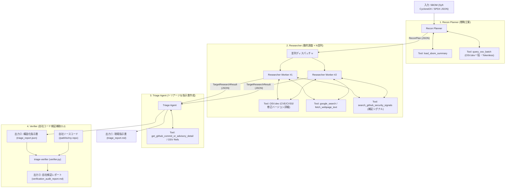
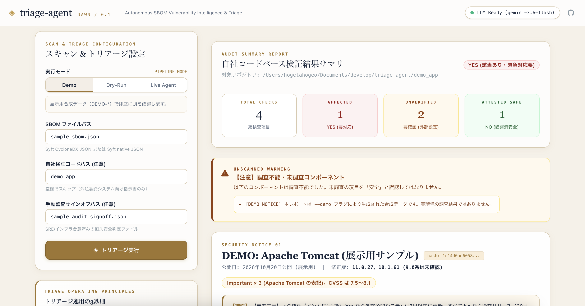
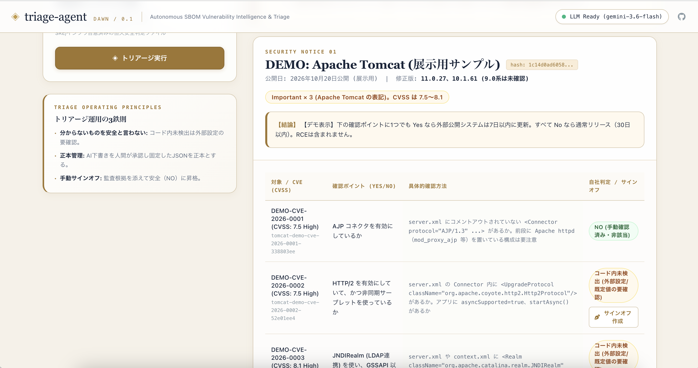

# triage-agent

自社のSBOM（推移的依存を含むライブラリ一覧）を入力として受け取り、LLMエージェントが自律的に巡回・調査・トリアージ・指示書生成を行うマルチエージェントシステムです。

---

## 1. アーキテクチャ概要

本システムは、過剰な独自コードや複雑なフレームワークを排し、Geminiのネイティブな **Function Calling**・**Google Search Grounding**・**Structured Outputs (Pydantic)** を最大限活用した3フェーズの自律型パイプラインです。
また、**Tokenless Architecture (ADR-014)** を採用しており、GitHub PAT（Personal Access Token）の管理・漏洩リスクを排除し、完全無料・オープンな **OSV.dev / OSV-Scanner** を脆弱性調査の第一線に配置しています。



### コンポーネント・エージェントの役割
1. **Recon Planner（戦略立案）:** SBOMから推移的依存を解析し、認証不要・高速な `OSV.dev` 一括照会結果を組み合わせ、攻撃対象領域とRCE傾向から「今すぐ深層調査すべきTop Nコンポーネント」と検索戦略（Pre-announcement事前予告探索を含む）を決定。
2. **Researcher（動的調査）:** OSV.dev による確定CVE・CVSS・影響/修正バージョンの高精度取得に加え、Gemini Google Search GroundingやGitHub公開シグナルを駆使し、公式パッチ予告や直近シグナルを能動的に調査。
3. **Triage Agent（発火条件特定・指示書作成）:** パッチのコミット差分（Diff）やAdvisory本文を精読し、「どの設定値（`config.xxx = true` 等）が有効な時に発火するか」を特定。CVSSスコア付きの現場即応指示書を出力。
4. **Verifier（補助CLI: 自社コードベース自動検証）:** 指示書内の「確認ポイント（Yes/No）」に基づき、自社リポジトリを自動走査して「自社で本当に発火条件を踏んでいるか」をAST構文解析およびテストコード分離により自動判定し、該当行付きの自社検証結果レポートを出力。

---

## 2. セットアップ

### 必要要件
- Python 3.11+
- Gemini API Key (または Vertex AI / ADC)
- **GitHub Token 不要 (Tokenless)**: OSV.dev を使用するためトークン設定なしですぐに動作します。

### インストール
```bash
# 仮想環境の作成と有効化
python3 -m venv .venv
source .venv/bin/activate

# パッケージのインストール
pip install -e .
```

### 環境設定 (`.env`)
`.env.example` をコピーして `.env` を作成します：
```bash
cp .env.example .env
```

```bash
# .env
GEMINI_API_KEY="your-gemini-api-key"

# ベースモデル（高速・安定・最新の gemini-3.5-flash 推奨）
GEMINI_MODEL="gemini-3.5-flash"

# （任意）役割ごとにモデルを分けたい場合のみ設定
# GEMINI_MODEL_PLANNER="gemini-2.5-pro"
# GEMINI_MODEL_RESEARCHER="gemini-3.5-flash"
# GEMINI_MODEL_TRIAGE="gemini-2.5-pro"

# GitHub Token (完全任意: 通常は未設定でOK。OSV.devによりトークンレスで動作します)
# GITHUB_TOKEN=""
```

---

## 3. 使い方

### 3.1 Syft によるSBOM生成
> 💡 **推奨スキャン手法（コンテナイメージ単位）:**
> `syft scan dir:.` でソースディレクトリのみをスキャンした場合、**Node.js本体、PHPランタイム、OS共有ライブラリ（OpenSSL, Brotli等）** といった基盤層がSBOMに含まれません（例: Brotli脆弱性 CVE-2026-111497 の見落としリスク）。
> 本番環境にデプロイするコンテナイメージ全体をスキャンすることを強く推奨します。

```bash
# 【推奨】コンテナイメージ全体をスキャン (CycloneDX JSON または SPDX JSON)
syft scan docker:my-org/my-app:latest -o cyclonedx-json > my_sbom.json
# または SPDX JSON (ISO/IEC 5962 国際標準形式)
syft scan docker:my-org/my-app:latest -o spdx-json > my_spdx_sbom.json

# 【簡易】ソースコードディレクトリのみのスキャン (言語ライブラリのみ)
syft scan dir:. -o cyclonedx-json > my_sbom.json
```

---

### 3.2 トリアージエージェントのCLI実行
```bash
# 基本実行 (Markdownレポートを output_report.md に出力)
python -m triage_agent.cli --sbom my_sbom.json --output output_report.md

# モデルを一時的に変更して実行 (例: flash)
python -m triage_agent.cli --sbom my_sbom.json --model gemini-2.5-flash

# 機械可読なJSON形式で指示書を出力 (verifier との連携用)
python -m triage_agent.cli --sbom my_sbom.json --output triage_report.json

# 機能展示・デモモード（明確に DEMO-* と識別可能な合成データで即座に挙動確認）
python -m triage_agent.cli --demo --output demo_triage_report.json
```

### 3.3 自社コードベース自動検証（補助CLI: triage-verifier）
自社でソースコードを保有している場合、指示書内の「確認ポイント」に基づいて自社リポジトリを自動走査し、**「自社で本当に発火条件を踏んでいるか（Yes / No）」の検証結果レポート** を自動生成できます。

```bash
# 1. 補助CLIで自社コードベースを自動検証
python -m triage_agent.verifier --report triage_report.json --code-dir /path/to/my-repo --output verification_audit_report.md

# 2. 人手による確認結果（インフラ設定確認済み・非該当）を反映した監査レポートの生成
python -m triage_agent.verifier --report triage_report.json --code-dir /path/to/my-repo --audit-file sample_audit_signoff.json

# 3. もしくは triage-agent 実行時にワンライナーで同時実行
python -m triage_agent.cli --sbom my_sbom.json --verify-code /path/to/my-repo
```

生成される検証レポート（[sample_verification_audit_report.md](sample_verification_audit_report.md)）例：
- **総合判定:** `【要対応あり (ACTION REQUIRED)】`
- **urllib3:** `コード内未検出 (外部設定/既定値の要確認)` → ソース内未検出だが外部設定（`HTTPS_PROXY`等）の確認が必要（※`sample_audit_signoff.json` のような手動監査サインオフを渡すことで `NO (手動確認済み・安全)` へ移行可能）
- **jsonwebtoken:** `YES (要対応)` → `server.js:6: return jwt.verify(token, "secret-key")` を自動検知（7日以内の修正推奨）

> 🔒 **機密保持・漏洩防止（攻撃地図化の防止）:**
> 実際の脆弱性スキャン・検証によって生成される `triage_report.json`, `verification_audit_report.md`, `audit_signoff.json` 等は、システムの脆弱箇所や該当コード行を特定する「攻撃地図」となり得るため、デフォルトの `.gitignore` により Git 管理から安全に除外されます（同梱の `sample_*` ファイルのみが動作確認用として管理されています）。CI/CD連携や実環境での運用時は、アクセス制限されたストレージへの期限付き保存（TTL）を行ってください。

### 3.4 Web GUI ダッシュボード（DAWN Studio）




ブラウザ上で対話的にトリアージ指示書の閲覧、自社コードベース検証、外注委託先への確認結果（手動監査サインオフ）の登録を行える軽量Web GUIを提供しています。

```bash
# Web GUI ダッシュボードの起動（ブラウザで http://127.0.0.1:8080 が自動的に開きます）
python -m triage_agent.cli --gui
# または
python -m triage_agent.web_ui
```

> 🔒 **エンタープライズ・高セキュリティ設計 & UX:**
> - **リアルタイム進捗ストリーミング (Zero Dependency):** 追加のフレームワークやWebSocketライブラリを使わず、標準の `http.server` による Server-Sent Events (SSE) で調査進捗率（0〜100%）、Phase インジケーター、および現在精読中のパッケージ名をリアルタイム表示。待ち時間のストレスを解消。
> - **堅牢なCSRF防護:** サーバー起動時に生成される動的CSRFトークン検証、Host/Originヘッダーの厳格な検証、および `Content-Type: application/json` の強制により、外部サイトからの不正なクロスオリジン書き込みを完全に遮断。
> - **パストラバーサル防止:** 読み書き対象のファイルパス（SBOM、コード、監査ファイル）を作業ディレクトリ配下に厳格に制限。
> - **完全オフライン対応（Zero CDN）:** 外部CDNスクリプト（TailwindやFont Awesome）への依存を排除し、すべて自己完結したCSS/シンボルで構成。社外アクセスが制限された金融機関等の閉域網・イントラネットでも画面崩れなく安全に動作します。
> - **外注・ベンダー管理対応:** ソースコードを保有しない外注委託システムであっても、早見表の確認ポイントごとに「ベンダー確認済み・非該当」「要対応」などの回答とエビデンスを直接記録・保存できます。

### 3.5 監査サインオフ（Audit Sign-off）の概念と運用ワークフロー

セキュリティ現場において、**「ソースコード内で設定キーワードが見つからないこと」は決して「安全（非該当）」を意味しません。**
ミドルウェアのデフォルト有効設定（例: PHPの `session.upload_progress.enabled`）や、環境変数、インフラ側の設定（`server.xml` や K8s マニフェスト）に依存する脆弱性は、コード走査だけでは安全を証明できないためです。

本システムでは、未検出を安易に安全と言わず、**「人間のエンジニア/SREがインフラ設定や既定値を確認し、根拠を残して承認（サインオフ）して初めて安全（NO）とする」** ガバナンスワークフローを標準実装しています。

### 3.6 Self-Triage（自己診断・ドッグフーディング）と「3つの鮮度」（ADR-018）

本システムは、対象システムを診断するだけでなく、**「triage-agent 自身もメンテナンスし続ける前提のソフトウェア」** として位置づけ、自分自身の依存関係とソースコードを自ら診断する **Self-Triage（自己診断）** 機能を標準搭載しています。

脆弱性トリアージが現場で真に機能するためには、以下の **「3つの鮮度」** を保つ運用が不可欠です：

1. **対象システムの鮮度:** 何年も放置された塩漬けシステムでは、ライブラリ1つにつき脆弱性が数十件噴出し、修正もメジャーバージョンを跨ぐため48時間での対応は不可能です。普段から Renovate 等で依存関係を最新に近づけておく運用の土台があってこそ、トリアージツールが威力を発揮します。
2. **SBOM の鮮度:** SBOM が古いと、すでに更新されたライブラリで誤警報が出たり、新しく追加されたライブラリが見落とされます。リリースのたびに CI で SBOM を再生成する仕組みが必要です。また、本システム自身も `requirements.lock` で依存関係を固定し、自己診断の対象として SBOM を生成することで、「今日インストールされた最新版で常にグリーンになる形骸化」を防ぎます。
3. **ツールの鮮度:** OSV や GitHub の API 仕様、LLM モデル名、プロンプトの確認ポイントの型は時間とともに風化します。triage-agent 自身の SBOM（**Python ランタイム自身を含む**）を自身で定期スキャン（ドッグフーディング）することで、外部 API の仕様変更や利用ライブラリの脆弱性を即座に検知できます。

> ⚠️ **定期実行の自動停止（GitHub Actions 60日ルールと鮮度の教訓）:**
> GitHub Actions のスケジュール実行（cron）は、パブリックリポジトリに60日間コミットや更新がないと **自動的に無効化（disable）される仕様** になっています。リポジトリ自体が塩漬けになると自己診断すら止まってしまうという現実は、まさに「普段から定期的にメンテナンスし続ける組織運用」の重要性を象徴しています。

```bash
# triage-agent 自身の依存関係SBOMを動的生成し、自社コードベース（src/triage_agent）を自己診断
python -m triage_agent.cli --self-triage

# CI/CD 向けガードレール: 調査不能コンポーネントや YES 判定が存在する場合に非ゼロ終了 (exit 2)
python -m triage_agent.cli --self-triage --fail-on unscanned,yes

# オフライン（シミュレーション）で自己診断を実行
python -m triage_agent.cli --self-triage --dry-run

# ワンライナースクリプトによる実行
./scripts/self_triage.sh
```

> 💡 **CI/CD 定期自動診断:**
> `.github/workflows/self-triage.yml` が用意されており、毎週月曜日に自動でドッグフーディング自己診断を実行します。サプライチェーン保護のためアクションをコミット SHA で固定し、機密漏洩・攻撃地図化防止（ADR-013）のため GitHub Step Summary には件数サマリのみを出力します。

#### 運用ワークフロー
1. **初期検証の実行:**
   `triage-verifier` を実行すると、コード内で検出されなかった外部設定依存項目は `コード内未検出 (外部設定/既定値の要確認)`（黄色）として出力されます。
2. **インフラ/外部設定の手動確認:**
   SREやインフラ担当者が、インフラ設計書、K8s ConfigMap、ミドルウェア設定ファイル等を確認します。
3. **サインオフファイル（`audit_signoff.json`）の作成:**
   確認者、確認日、および確認根拠（Evidence）を明記したサインオフファイルをリポジトリ内またはCIで管理します。
4. **監査レポートの再生成:**
   `--audit-file audit_signoff.json` を付与して再実行することで、該当項目が `NO (手動確認済み・非該当)`（緑色）に更新され、監査証跡付きの最終レポート（`verification_audit_report.md`）が完成します。

#### サインオフJSONフォーマット例 (`sample_audit_signoff.json`):
```json
{
  "attestations": [
    {
      "check_point_id": "tomcat-demo-cve-2026-0001-338803ee",
      "notice_hash": "1c14d0ad6058",
      "cve_id": "DEMO-CVE-2026-0001",
      "check_point_yes_no": "AJP コネクタを有効にしているか",
      "report_version": "1.0",
      "status": "NO (手動確認済み・非該当)",
      "reviewer": "SREチーム 山田",
      "date": "2026-10-25",
      "evidence": "本番環境の server.xml を確認。AJP コネクタの定義はコメントアウトされており非該当。"
    }
  ]
}
```

> 🛡️ **安全側設計（誤爆・見落とし防止）:**
> - **順序非依存・決定論的ID:** `check_point_id` は「何番目か」ではなく「CVE + 質問文」から暗号ハッシュで生成されるため、第2版で確認ポイントの並び順が変わっても誤った項目にサインオフが当たることはありません。
> - **Notice Fingerprint (`notice_hash`) による自動失効:** お知らせに含まれる確認ポイント構成のハッシュを保持。第2版で新たな確認項目が追加されたり質問文が変更されると、ハッシュが変わり過去のサインオフは自動的に失効して再確認（黄色）を促します。
> - **ステータス検証:** `status` が `NO` で始まっている場合のみ安全として集計されます。

### 3.6 実務運用フロー：AI下書きと正本（Official Baseline）管理

LLMによる文章生成は、実行ごとに言い回しが微妙に変わる可能性があります。毎回レポートをゼロから再生成して検証を回すと、質問文の微細な変化によってIDが変わり、以前作成したサインオフが当たらなくなってエンジニアが疲弊する原因になります。

そのため、実務では**「AIは版の下書きを作り、確定・配布された版を正本とする」** 2段階運用を推奨します。

```text
[SBOM] ──> (triage-agent) ──> triage_v1.0_draft.json (AI下書き)
                                     │
                             [人の確認・微修正]
                                     ↓
                         triage_v1.0_official.json (第1版 正本として保存)
                                     │
           ┌─────────────────────────┴─────────────────────────┐
           ↓                                                   ↓
   【外注委託システム】                                 【内製システム】
ベンダーへ指示書送付                               triage-verifier で自動走査 & 
(Yesなら7日以内/Noなら30日)                        正本に対してサインオフを突合・確定
```

1. **AIは「版の下書き（Draft）」を作成:**
   `python -m triage_agent.cli --sbom my_sbom.json --output reports/triage_v1.0_draft.json`
2. **人間がレビューして「第1版の正本（Official Baseline）」として確定・保存:**
   内容を確定し、`reports/triage_v1.0_official.json` としてGitリポジトリ等に保存します。
3. **自社検証・サインオフ照合は「正本」に対して実行:**
   `python -m triage_agent.verifier --report reports/triage_v1.0_official.json --code-dir . --audit-file audit_signoff.json`
   固定された正本に対して検証を行うため、IDブレによる再確認の二度手間が一切発生しません。
4. **新情報・新バージョン公開時:**
   `triage-agent` で新版（第2版）を作成。内容に変更があった脆弱性のみ `notice_hash` により自動で再確認（黄色）を促します。

---

## 4. プロジェクト構成とドキュメント

```text
triage-agent/
├── pyproject.toml            # プロジェクト定義と依存関係
├── .env.example              # 設定テンプレート
├── sample_sbom.json          # 動作確認用Syft CycloneDX SBOM
├── docs/                     # 開発・設計・メンテナンスドキュメント
│   ├── architecture.md       # 全体アーキテクチャ・エージェントトポロジー
│   ├── decision.md           # アーキテクチャ決定記録 (ADR)
│   ├── todo.md               # 今後のロードマップとバックログ
│   └── implementation_plan.md# 初回設計計画書
├── prompts/
│   ├── recon_planner.md      # 戦略立案プロンプト
│   ├── researcher.md         # 動的調査プロンプト
│   └── triage.md             # トリアージ・指示書生成プロンプト
└── src/
    └── triage_agent/
        ├── config.py         # 環境変数・モデル名管理
        ├── schemas.py        # Pydanticデータスキーマ
        ├── cli.py            # メインCLIエントリポイント
        ├── pipeline.py       # 共有パイプライン実行コア
        ├── web_ui.py         # 軽量・セキュアWeb GUIダッシュボード
        ├── verifier.py       # 自社コードベース自動検証補助CLI
        ├── tools/
        │   ├── sbom.py       # Syft CycloneDX / JSON パーサー
        │   ├── osv.py        # OSV.dev 一括照会 API
        │   ├── github.py     # GitHub Advisories / Commits / Diff 取得
        │   └── web.py        # Webページ本文スクレイパー
        └── agents/
            ├── planner.py    # Recon Planner エージェント
            ├── researcher.py # Researcher エージェント
            └── triage.py     # Triage エージェント
```

### 開発・設計ドキュメント一覧
- [architecture.md](docs/architecture.md): システム設計、エージェント協調モデル、データフロー、ツール仕様
- [decision.md](docs/decision.md): なぜこの言語・SDK・ツール構成・出力フォーマットにしたのかという設計判断記録（ADR）
- [todo.md](docs/todo.md): CI/CD連携やAST構文解析対応など今後の開発ロードマップ
- [implementation_plan.md](docs/implementation_plan.md): 初期開発時の設計計画書
