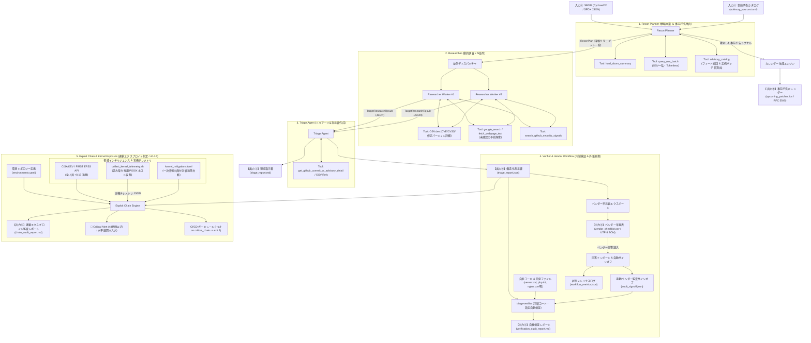

# triage-agent

> **「365日の突発的な緊急対応を、コントロールされた計画作業へ」**  
> 自社のSBOMから、CVEが公表される前の「事前予告（Pre-announcements）」を定点巡回してパッチ予定日をカレンダー（iCalendar）に先回り登録。パッチ公開後はコミット差分を精読し、自社設定・コードが真に脆弱性を踏んでいるかの「Yes/No早見表」を即時生成する、現場即応型の自律脆弱性トリアージエージェントです。

---

## なぜ triage-agent なのか（既製品との違い）

Tanium、Nexus IQ、Snyk、Trivy などの既存製品は「CVEが発行された後の既知脆弱性の検知と照合」に優れています。しかし現場のSREやセキュリティ担当者が真に疲弊しているのは、**「金曜夕方に突然降ってくる緊急パッチ対応（人の手配・ベンダー調整・本番変更管理申請パニック）」** です。

本ツールは、この突発的な緊急対応を根本から変革します：

1. **パッチの日を、前もって予定に入れられる（事前予告カレンダー）:**
   Node.js 公式ブログ、OpenSSL announce、Go、Tomcat、Oracle CPU、Patch Tuesday などの「事前リリース予告」を自社SBOMと自動突合し、iCalendar（`.ics`）として出力。Google カレンダーや Outlook に登録することで、**「輪番の事前確保」「ベンダー作業枠の仮押さえ」「金融本番変更申請（RFC）の先行起票」** をパッチ公開前に完了できます。
2. **「コードではなくデータが堀になる」コミュニティ主導カタログ:**
   「どのOSSが、どこで、どんな形で予告を出すか」の一覧（`advisory_sources.toml`）を宣言的オープンデータとして管理。利用者が増えるほど監視網が厚くなるネットワーク効果（堀）を形成します。
3. **コードだけでなく「設定ファイル」を直接検証（Verifier）:**
   現場で発火可否を分けるのは、コードそのものより設定（Tomcat `server.xml` の AJP 設定、PHP `php.ini`、Nginx の `http2` ディレクティブ等）です。設定ファイルとコード双方を走査し、Yes/No早見表に即答します。
4. **ベンダーとの往復をツールに乗せる（Excel / CSV 帳票出力）:**
   早見表を Excel/CSV でワンクリック出力し、ベンダーの回答を取り込んでタイムスタンプ付きでサインオフ確定。「配布までの時間」「往復回数」を定量記録します。
5. **単一CVSSにとらわれない「連鎖エクスプロイト」と「カーネル露出」の自動判定（v0.4.0 / ADR-019）:**
   単体では Medium/High に留まるカーネル LPE（例: Fragnesia CVE-2026-46300）が、外部露出アプリの RCE 足場（例: PHP2Shell）と同一ホスト上で結合した際のホスト掌握・同居マイクロサービスへの水平展開（Blast Radius）リスクを決定論的に判定。実機テレメトリ（パッケージ版、`loaded_modules`、IPsec/xfrm 競合）と照合し、48時間以内／2週間以内の厳格な対応期限を提示します。

---

## 1. アーキテクチャ概要

本システムは、過剰な独自コードや複雑なフレームワークを排し、Geminiのネイティブな **Function Calling**・**Google Search Grounding**・**Structured Outputs (Pydantic)** を最大限活用した自律型パイプラインです。
また、**Tokenless Architecture (ADR-014)** を採用しており、GitHub PAT（Personal Access Token）の管理・漏洩リスクを排除し、完全無料・オープンな **OSV.dev / OSV-Scanner** を脆弱性調査の第一線に配置しています。



### コンポーネント・エージェントの役割
1. **Recon Planner（戦略立案 ＆ 事前予告抽出）:** SBOMから推移的依存を解析し、認証不要・高速な `OSV.dev` 一括照会結果を組み合わせ、攻撃対象領域とRCE傾向から「今すぐ深層調査すべきTop Nコンポーネント」を決定。同時に、コミュニティ監視カタログ（`advisory_sources.toml`）と突合して公式フィード（RSS/Atom）や次回定例リリース日（Oracle CPU / Patch Tuesday等）から**事前予告イベントを決定論的に抽出**し、パッチ公開前の先回りアクション用カレンダー（`upcoming_patches.ics`）を出力。
2. **Researcher（動的調査）:** OSV.dev による確定CVE・CVSS・影響/修正バージョンの高精度取得に加え、Gemini Google Search GroundingやGitHub公開シグナルを駆使し、公式パッチ予告やWeb上の未確認シグナルを能動的に調査。
3. **Triage Agent（発火条件特定・指示書作成）:** パッチのコミット差分（Diff）やAdvisory本文を精読し、「どの設定値（`config.xxx = true` 等）が有効な時に発火するか」を特定。CVSSスコア付きの現場即応指示書（Markdown / JSON）を出力。
4. **Verifier & Vendor Workflow（自社検証 ＆ 外注連携）:** 
   - **内製システム:** 指示書内の「確認ポイント（Yes/No）」に基づき、自社リポジトリのソースコード（AST構文木走査・テストコード分離）およびミドルウェア設定ファイル（Tomcat `server.xml`、PHP `php.ini`、Nginx `nginx.conf` 等）を自動走査し、客観的3状態（YES / 外部設定要確認 / NO）で自社検証レポートを出力。
   - **外注委託システム:** 指示書からワンクリックで Excel / CSV 帳票（`vendor_checklist.csv`）を出力。ベンダー回答を取り込んでタイムスタンプ付きサインオフ（`audit_signoff.json`）を自動確定し、試行成果測定用メトリクス（`workflow_metrics.json`）を記録。

5. **Exploit Chain & Kernel Exposure Engine（連鎖エクスプロイト判定 / v0.4.0）:**
   - 単体のCVSSスコア（例: 7.8）にとらわれず、「外部公開/コード実行環境のRCE足場（例: PHP2Shell）」×「同一共有カーネル上のOS権限昇格（例: Fragnesia CVE-2026-46300）」の結合リスクを決定論的に判定。
   - 実機テレメトリ（パッケージ版、`loaded_modules`、IPsec/xfrm競合）と照合し、48時間以内（即時緩和）または2週間以内（横展開防止）の厳格な対応期限と、同一ノードに同居する別マイクロサービスへの水平展開（Blast Radius）リスクを出力。

---

## 2. セットアップ

### 必要要件
- Python 3.11+
- Gemini API Key (または Vertex AI / ADC)
- **GitHub Token 不要 (Tokenless)**: OSV.dev を使用するためトークン設定なしですぐに動作します。

### インストール
```bash
# 仮想環境の作成と有効化
python3 -m venv .venv
source .venv/bin/activate

# パッケージのインストール
pip install -e .
```

### 環境設定 (`.env`)
`.env.example` をコピーして `.env` を作成します：
```bash
cp .env.example .env
```

```bash
# .env
GEMINI_API_KEY="your-gemini-api-key"

# ベースモデル（高速・安定・最新の gemini-3.5-flash 推奨）
GEMINI_MODEL="gemini-3.5-flash"

# （任意）役割ごとにモデルを分けたい場合のみ設定
# GEMINI_MODEL_PLANNER="gemini-2.5-pro"
# GEMINI_MODEL_RESEARCHER="gemini-3.5-flash"
# GEMINI_MODEL_TRIAGE="gemini-2.5-pro"

# GitHub Token (完全任意: 通常は未設定でOK。OSV.devによりトークンレスで動作します)
# GITHUB_TOKEN=""
# ※注意: GITHUB_TOKEN を明示設定した場合にトークンが無効または期限切れ（HTTP 401 Bad credentials）
# であるときは、設定ミスを見逃さないよう「未調査コンポーネント」として警告され、--fail-on unscanned で CI が停止します。
```

---

## 3. 使い方

### 3.1 Syft によるSBOM生成
> 💡 **推奨スキャン手法（コンテナイメージ単位）:**
> `syft scan dir:.` でソースディレクトリのみをスキャンした場合、**Node.js本体、PHPランタイム、OS共有ライブラリ（OpenSSL, Brotli等）** といった基盤層がSBOMに含まれません（例: Brotli脆弱性 CVE-2026-111497 の見落としリスク）。
> 本番環境にデプロイするコンテナイメージ全体をスキャンすることを強く推奨します。

```bash
# 【推奨】コンテナイメージ全体をスキャン (CycloneDX JSON または SPDX JSON)
syft scan docker:my-org/my-app:latest -o cyclonedx-json > my_sbom.json
# または SPDX JSON (ISO/IEC 5962 国際標準形式)
syft scan docker:my-org/my-app:latest -o spdx-json > my_spdx_sbom.json

# 【簡易】ソースコードディレクトリのみのスキャン (言語ライブラリのみ)
syft scan dir:. -o cyclonedx-json > my_sbom.json
```

---

### 3.2 トリアージエージェントのCLI実行
```bash
# 基本実行 (Markdownレポートを output_report.md に出力)
python -m triage_agent.cli --sbom my_sbom.json --output output_report.md

# モデルを一時的に変更して実行 (例: flash)
python -m triage_agent.cli --sbom my_sbom.json --model gemini-2.5-flash

# 機械可読なJSON形式で指示書を出力 (verifier との連携用)
python -m triage_agent.cli --sbom my_sbom.json --output triage_report.json

# 事前予告カレンダー（iCalendar）を同時出力
python -m triage_agent.cli --sbom my_sbom.json --calendar pre_advisories.ics

# 機能展示・デモモード（明確に DEMO-* と識別可能な合成データで即座に挙動確認）
python -m triage_agent.cli --demo --output demo_triage_report.json --calendar demo_calendar.ics
```

### 3.3 自社コードベース自動検証（補助CLI: triage-verifier）
自社でソースコードを保有している場合、指示書内の「確認ポイント」に基づいて自社リポジトリを自動走査し、**「自社で本当に発火条件を踏んでいるか（Yes / No）」の検証結果レポート** を自動生成できます。

```bash
# 1. 補助CLIで自社コードベースを自動検証
python -m triage_agent.verifier --report triage_report.json --code-dir /path/to/my-repo --output verification_audit_report.md

# 2. 人手による確認結果（インフラ設定確認済み・非該当）を反映した監査レポートの生成
python -m triage_agent.verifier --report triage_report.json --code-dir /path/to/my-repo --audit-file sample_audit_signoff.json

# 3. もしくは triage-agent 実行時にワンライナーで同時実行
python -m triage_agent.cli --sbom my_sbom.json --verify-code /path/to/my-repo
```

生成される検証レポート（[sample_verification_audit_report.md](sample_verification_audit_report.md)）例：
- **総合判定:** `【要対応あり (ACTION REQUIRED)】`
- **urllib3:** `コード内未検出 (外部設定/既定値の要確認)` → ソース内未検出だが外部設定（`HTTPS_PROXY`等）の確認が必要（※`sample_audit_signoff.json` のような手動監査サインオフを渡すことで `NO (手動確認済み・安全)` へ移行可能）
- **jsonwebtoken:** `YES (要対応)` → `server.js:6: return jwt.verify(token, "secret-key")` を自動検知（7日以内の修正推奨）

> 🔒 **機密保持・漏洩防止（攻撃地図化の防止）:**
> 実際の脆弱性スキャン・検証によって生成される `triage_report.json`, `verification_audit_report.md`, `audit_signoff.json` 等は、システムの脆弱箇所や該当コード行を特定する「攻撃地図」となり得るため、デフォルトの `.gitignore` により Git 管理から安全に除外されます（同梱の `sample_*` ファイルのみが動作確認用として管理されています）。CI/CD連携や実環境での運用時は、アクセス制限されたストレージへの期限付き保存（TTL）を行ってください。

### 3.4 Web GUI ダッシュボード（DAWN Studio）


ブラウザ上で対話的にトリアージ指示書の閲覧、自社コードベース検証、外注委託先への確認結果（手動監査サインオフ）の登録を行える軽量Web GUIを提供しています。

```bash
# Web GUI ダッシュボードの起動（ブラウザで http://127.0.0.1:8080 が自動的に開きます）
python -m triage_agent.cli --gui
# または
python -m triage_agent.web_ui
```

> 🔒 **エンタープライズ・高セキュリティ設計 & UX:**
> - **レポート保存と継続編集（Import / Export）:** 画面上で生成されたトリアージ指示書（Markdown / JSON）および自社検証レポート（Markdown）を、ディレクトリトラバーサル対策済みの安全なファイルパスに直接保存可能。また、過去に保存した `triage_report.json` を再読み込みすることで、外部API照会を行わずにUIを瞬時に復元し、サインオフの追加やコード検証を継続編集できます。ブラウザからの直接ワンクリックダウンロード（MD / JSON）にも対応。
> - **リアルタイム進捗ストリーミング (Zero Dependency):** 追加のフレームワークやWebSocketライブラリを使わず、標準の `http.server` による Server-Sent Events (SSE) で調査進捗率（0〜100%）、Phase インジケーター、および現在精読中のパッケージ名をリアルタイム表示。待ち時間のストレスを解消。
> - **堅牢なCSRF防護:** サーバー起動時に生成される動的CSRFトークン検証、Host/Originヘッダーの厳格な検証、および `Content-Type: application/json` の強制により、外部サイトからの不正なクロスオリジン書き込みを完全に遮断。
> - **パストラバーサル防止:** 読み書き対象のファイルパス（SBOM、コード、監査ファイル）を作業ディレクトリ配下に厳格に制限。
> - **完全オフライン対応（Zero CDN）:** 外部CDNスクリプト（TailwindやFont Awesome）への依存を排除し、すべて自己完結したCSS/シンボルで構成。社外アクセスが制限された金融機関等の閉域網・イントラネットでも画面崩れなく安全に動作します。
> - **外注・ベンダー管理対応:** ソースコードを保有しない外注委託システムであっても、早見表の確認ポイントごとに「ベンダー確認済み・非該当」「要対応」などの回答とエビデンスを直接記録・保存できます。

### 3.5 監査サインオフ（Audit Sign-off）の概念と運用ワークフロー

セキュリティ現場において、**「ソースコード内で設定キーワードが見つからないこと」は決して「安全（非該当）」を意味しません。**
ミドルウェアのデフォルト有効設定（例: PHPの `session.upload_progress.enabled`）や、環境変数、インフラ側の設定（`server.xml` や K8s マニフェスト）に依存する脆弱性は、コード走査だけでは安全を証明できないためです。

本システムでは、未検出を安易に安全と言わず、**「人間のエンジニア/SREがインフラ設定や既定値を確認し、根拠を残して承認（サインオフ）して初めて安全（NO）とする」** ガバナンスワークフローを標準実装しています。

### 3.6 Self-Triage（自己診断・ドッグフーディング）と「3つの鮮度」（ADR-018）

本システムは、対象システムを診断するだけでなく、**「triage-agent 自身もメンテナンスし続ける前提のソフトウェア」** として位置づけ、自分自身の依存関係とソースコードを自ら診断する **Self-Triage（自己診断）** 機能を標準搭載しています。

脆弱性トリアージが現場で真に機能するためには、以下の **「3つの鮮度」** を保つ運用が不可欠です：

1. **対象システムの鮮度:** 何年も放置された塩漬けシステムでは、ライブラリ1つにつき脆弱性が数十件噴出し、修正もメジャーバージョンを跨ぐため48時間での対応は不可能です。普段から Renovate 等で依存関係を最新に近づけておく運用の土台があってこそ、トリアージツールが威力を発揮します。
2. **SBOM の鮮度:** SBOM が古いと、すでに更新されたライブラリで誤警報が出たり、新しく追加されたライブラリが見落とされます。リリースのたびに CI で SBOM を再生成する仕組みが必要です。また、本システム自身も `requirements-lock.txt` で依存関係を固定し、自己診断の対象として SBOM を生成することで、「今日インストールされた最新版で常にグリーンになる形骸化」を防ぎます。Dependabot はこの `requirements-lock.txt` を自動認識して定期的に依存関係の更新 PR を起票します。
3. **ツールの鮮度:** OSV や GitHub の API 仕様、LLM モデル名、プロンプトの確認ポイントの型は時間とともに風化します。triage-agent 自身の SBOM（**Python ランタイム自身を含む**）を自身で定期スキャン（ドッグフーディング）することで、外部 API の仕様変更や利用ライブラリの脆弱性を即座に検知できます。

> ⚠️ **定期実行の自動停止（GitHub Actions 60日ルールと鮮度の教訓）:**
> GitHub Actions のスケジュール実行（cron）は、パブリックリポジトリに60日間コミットや更新がないと **自動的に無効化（disable）される仕様** になっています。リポジトリ自体が塩漬けになると自己診断すら止まってしまうという現実は、まさに「普段から定期的にメンテナンスし続ける組織運用」の重要性を象徴しています。

```bash
# triage-agent 自身の依存関係SBOMを動的生成し、自社コードベース（src/triage_agent）を自己診断
python -m triage_agent.cli --self-triage

# CI/CD 向けガードレール: 調査不能コンポーネントや YES 判定が存在する場合に非ゼロ終了 (exit 2)
python -m triage_agent.cli --self-triage --fail-on unscanned,yes

# オフライン（シミュレーション）で自己診断を実行
python -m triage_agent.cli --self-triage --dry-run

# ワンライナースクリプトによる実行
./scripts/self_triage.sh
```

> 💡 **CI/CD 定期自動診断:**
> `.github/workflows/self-triage.yml` が用意されており、毎週月曜日に自動でドッグフーディング自己診断を実行します。サプライチェーン保護のためアクションをコミット SHA で固定し、機密漏洩・攻撃地図化防止（ADR-013）のため GitHub Step Summary には件数サマリのみを出力します。

#### 運用ワークフロー
1. **初期検証の実行:**
   `triage-verifier` を実行すると、コード内で検出されなかった外部設定依存項目は `コード内未検出 (外部設定/既定値の要確認)`（黄色）として出力されます。
2. **インフラ/外部設定の手動確認:**
   SREやインフラ担当者が、インフラ設計書、K8s ConfigMap、ミドルウェア設定ファイル等を確認します。
3. **サインオフファイル（`audit_signoff.json`）の作成:**
   確認者、確認日、および確認根拠（Evidence）を明記したサインオフファイルをリポジトリ内またはCIで管理します。
4. **監査レポートの再生成:**
   `--audit-file audit_signoff.json` を付与して再実行することで、該当項目が `NO (手動確認済み・非該当)`（緑色）に更新され、監査証跡付きの最終レポート（`verification_audit_report.md`）が完成します。

#### サインオフJSONフォーマット例 (`sample_audit_signoff.json`):
```json
{
  "attestations": [
    {
      "check_point_id": "tomcat-demo-cve-2026-0001-338803ee",
      "notice_hash": "1c14d0ad6058",
      "cve_id": "DEMO-CVE-2026-0001",
      "check_point_yes_no": "AJP コネクタを有効にしているか",
      "report_version": "1.0",
      "status": "NO (手動確認済み・非該当)",
      "reviewer": "SREチーム 山田",
      "date": "2026-10-25",
      "evidence": "本番環境の server.xml を確認。AJP コネクタの定義はコメントアウトされており非該当。"
    }
  ]
}
```

> 🛡️ **安全側設計（誤爆・見落とし防止）:**
> - **順序非依存・決定論的ID:** `check_point_id` は「何番目か」ではなく「CVE + 質問文」から暗号ハッシュで生成されるため、第2版で確認ポイントの並び順が変わっても誤った項目にサインオフが当たることはありません。
> - **Notice Fingerprint (`notice_hash`) による自動失効:** お知らせに含まれる確認ポイント構成のハッシュを保持。第2版で新たな確認項目が追加されたり質問文が変更されると、ハッシュが変わり過去のサインオフは自動的に失効して再確認（黄色）を促します。
> - **ステータス検証:** `status` が `NO` で始まっている場合のみ安全として集計されます。

### 3.6 実務運用フロー：AI下書きと正本（Official Baseline）管理

LLMによる文章生成は、実行ごとに言い回しが微妙に変わる可能性があります。毎回レポートをゼロから再生成して検証を回すと、質問文の微細な変化によってIDが変わり、以前作成したサインオフが当たらなくなってエンジニアが疲弊する原因になります。

そのため、実務では**「AIは版の下書きを作り、確定・配布された版を正本とする」** 2段階運用を推奨します。

```text
[SBOM] ──> (triage-agent) ──> triage_v1.0_draft.json (AI下書き)
                                     │
                             [人の確認・微修正]
                                     ↓
                         triage_v1.0_official.json (第1版 正本として保存)
                                     │
           ┌─────────────────────────┴─────────────────────────┐
           ↓                                                   ↓
   【外注委託システム】                                 【内製システム】
ベンダーへ指示書送付                               triage-verifier で自動走査 & 
(Yesなら7日以内/Noなら30日)                        正本に対してサインオフを突合・確定
```

1. **AIは「版の下書き（Draft）」を作成:**
   `python -m triage_agent.cli --sbom my_sbom.json --output reports/triage_v1.0_draft.json`
2. **人間がレビューして「第1版の正本（Official Baseline）」として確定・保存:**
   内容を確定し、`reports/triage_v1.0_official.json` としてGitリポジトリ等に保存します。
3. **自社検証・サインオフ照合は「正本」に対して実行:**
   `python -m triage_agent.verifier --report reports/triage_v1.0_official.json --code-dir . --audit-file audit_signoff.json`
   固定された正本に対して検証を行うため、IDブレによる再確認の二度手間が一切発生しません。
4. **新情報・新バージョン公開時:**
   `triage-agent` で新版（第2版）を作成。内容に変更があった脆弱性のみ `notice_hash` により自動で再確認（黄色）を促します。

### 3.7 事前予告カレンダー（Early Warning Calendar）と事前準備フロー

#### どんな時に作られるのか？
`triage-agent` の実行時、第1フェーズ（Recon Planner）において自社の SBOM 内のコンポーネントがコミュニティ監視カタログ（`advisory_sources.toml`）と自動突合されます。
公式フィード（RSS/Atom）を定点巡回して「未来のパッチ予告（Upcoming Security Releases）」を検知するか、Oracle CPU や Microsoft Patch Tuesday のような次回パッチ提供日（第3火曜日など）が計算されたタイミングで、**事前予告イベント** が生成されます。

> 📌 **公式事前予告ソースの対応状況（v0.3.0 現在）:**
> - **自動巡回・予定日・深刻度抽出（RSS/Atom フィード）:** Node.js, Apache Tomcat
> - **次回定例リリース日自動算出（公式スケジュール）:** Oracle Critical Patch Update, Microsoft Patch Tuesday, PostgreSQL
> - **監視先チャンネル・案内リンク提供（一次情報源）:** OpenSSL, Go, Python, Django, Apache HTTP Server, Nginx（※これらは自動予定日抽出ではなく、一次監視窓口の提示となります）

CLI 引数に `--calendar <path.ics>` を指定するか、Web GUI の「📅 予定表 (.ics)」ボタンをクリックすることで、RFC 5545 準拠の標準 iCalendar ファイルとして即座に出力されます。

```bash
# SBOM 照会と同時に事前予告カレンダーを生成
python -m triage_agent.cli --sbom my_sbom.json --output triage_report.md --calendar upcoming_patches.ics
```

#### 実務におけるメリット：パッチ公開前に何ができるか？
従来の脆弱性管理は「CVEが公開された直後」から始まります。しかし、金曜夕方や連休前夜に Critical CVE が公表されると、担当者の確保や変更管理申請が間に合わずパニックに陥ります。

事前予告カレンダー（`.ics`）を自社の Google カレンダーや Outlook、またはチーム共有カレンダーに取り込む（インポートする）ことで、**CVE が発行される前に以下の先回りアクションを完了** できます：

1. **オンコール・当番エンジニアの事前確保:**
   「来週火曜日に Node.js の High 深刻度セキュリティリリースがある」ことが分かっていれば、リリースの数日前に夜間・翌朝の対応担当者をあらかじめアサインしておけます。
2. **委託先ベンダーへの事前アラート（作業枠の仮押さえ）:**
   「○月○日に基盤ライブラリのパッチが出る見込みのため、翌営業日の適用テスト枠を空けておいてほしい」と事前に合意でき、当日の連絡の滞留や追加コストを防ぎます。
3. **本番変更管理申請（RFC: Request for Change）の先行起票:**
   厳格な金融システム等では本番適用の数日前までに変更申請の提出が必要です。「○月○日に予定されているセキュリティ修正の適用準備」として事前にドラフト申請を通しておくことで、パッチ公開後のリードタイムを最小化できます。

```text
【従来の運用】
パッチ公開(金曜夕方) ──> 緊急招集パニック ──> ベンダー連絡つかず ──> 週明け月曜から対応着手 (初動に数日要する)

【triage-agent の事前予告運用】
予告検知(1週間前) ──> 📅カレンダー予定登録 ──> 担当者確保・RFC先行起票 ──> パッチ公開当日に即応 (即座にYes/No判定へ)
```

#### 機密保護・社内情報の漏洩防止設計（ADR-013）
生成される `.ics` ファイルは共有カレンダーや外部SaaS（Google Calendar / Outlook）に取り込まれることを想定しています。そのため、カレンダーのタイトルや本文には **自社の内部パッケージ名、独自サービス名、および具体的なインベントリ情報は載せず、対象件数のみを記載** します：
- **予定タイトル:** `【事前予告 [High]】Node.js Security Releases (対象 2 件)`
- **予定説明:** 内部パッケージ名は伏せられ、`【該当コンポーネント】2 件 (詳細は社内トリアージレポートを参照)` と記載。

> ⚠️ **共有範囲に関する注意:**
> 個別のパッケージ名は載りませんが、情報源名（例: Oracle CPU、Tomcat、Node.js）と件数から利用している技術スタックの大枠は推測できます。全社公開カレンダー等へ登録する際は共有範囲にご留意ください。

#### 監視対象プロジェクトの追加方法（`advisory_sources.toml`）
事前予告を拾うロジックはコードではなく宣言的な TOML データ（[advisory_sources.toml](src/triage_agent/data/advisory_sources.toml)）として分離されています。社内で利用しているOSSや独自ベンダーがある場合、このファイルに項目を追加するだけでカレンダー連携の対象を自由に拡張できます：

```toml
[[sources]]
id = "my-framework"
name = "My Framework Security Releases"
ecosystem = "npm"
package_patterns = ["my-framework"]
purl_patterns = ["pkg:npm/my-framework*"]
url = "https://example.com/security/blog/"
feed_url = "https://example.com/security/feed.xml"
type = "rss_feed"
is_official = true
cadence_hint = "事前予告は通常、リリースの数日前に公開されます。"
keywords = ["security release", "vulnerabilities", "upcoming"]
default_preparations = [
    "当該日の輪番要員の手配",
    "ベンダー作業枠の事前仮押さえ"
]
```

> 💡 **定期日程（fixed_schedule）の追加ルール:**
> 定期日程は一行の書き間違いで毎月誤った確定予定を出してしまうリスクがあるため（「作った内容を本物に見せない」原則）、公式ドキュメントで日程算出規則が明記されているもの（Oracle CPU, Microsoft Patch Tuesday, PostgreSQL等）のみ登録可能です。TOML 内での `schedule_source_url`（公式根拠URL）の記載を必須とし、推測や慣行に基づく日程は受け付けません。
> 
> 💡 **役割カテゴリ（category）の指定:**
> - `category = "pre_announcement"`（既定）: 事前予告フィードや定期日程。カレンダー（.ics）生成や事前輪番確保の対象。
> - `category = "primary_advisory"`: Nginx や Apache HTTP Server などの公開後公式アドバイザリ一覧。カレンダーを日付なし項目で汚染することなく、公式一次情報源の参照リンクとして保持。

### 3.8 連鎖エクスプロイト（Exploit Chain）＆ Linux カーネル露出監査（v0.4.0 / ADR-019）

単一の脆弱性のCVSS値（例: 7.8）にとらわれず、「外部公開・コード実行環境（RCE足場）」×「同一ホスト上の未解消OSカーネルLPE（権限昇格）」の結合リスク、および同一共有ノードプールに同居する別マイクロサービスへの水平展開（Blast Radius）を決定論的に判定します。

#### 主な特徴
1. **多層シグナル足場判定:** CISA KEV 実侵害掲載、CVSS AV:N かつ C:H/I:H、公式RCE記述、拡張CWE（UAF 416, 未初期化 908, 注入 94等）の4層OR判定により、PHP2Shell（CVE-2026-109618/109619）のようなCWE未採番のゼロデイも即座に検知。また `untrusted_code`（CIランナーやコード実行基盤）はアプリCVE 0件でも足場として Critical 連鎖を発火。
2. **クラウドカーネル系統の識別:** AWS（`linux-aws`）、GCP（`linux-gcp`）、Azure（`linux-azure`）などのフレーバーを厳密に区別。台帳に当該系統の修正版がない場合は汎用（generic）版番号と比較して「修正済み」と誤認することを禁止し、「要確認」として安全側に倒します。
3. **実機テレメトリ検証:** `install /bin/false` 設定だけでなく、`/proc/modules` 内にモジュールが現在読み込まれていないか（再起動必要か）、IPsec / CNI（xfrm）の稼働による緩和副作用（通信切断）がないかを厳格判定。
4. **横展開・Blast Radius 可視化:** ノード root 奪取時に同居 Pod のメモリ・Secret・kubelet 認証情報がすべて漏洩する実被害を明示。内部限定ワークロードに対しても「2週間以内対応（定期メンテ先送り禁止）」の厳格な期限を課します。
5. **台帳の出典保護方針:** カーネル脆弱性台帳（`--chain-ledger` または `exploit_chain_ledger.json`）の修正版バージョンは、各ディストリビューションおよびカーネルフレーバー（AWS、GCP等）ごとの正確性を担保するため、現行 v0.4.0 では公式アドバイザリに基づく手入力・出典付き（`source_url` および `retrieved_at` の明記必須）で管理されます。出典が記載されていないエントリは、架空・推測データによる誤判定を防ぐため読み飛ばされ警告されます。なお、OSV からの修正版抽出（`extract_osv_fixed_ranges`）はクロスリリースのキー衝突を防ぐ内部ユーティリティとして整備されています。

```bash
# 1. ホストテレメトリの収集（読み取り専用・POSIX sh・ホスト変更なし・ホスト名匿名化）
sh scripts/collect_kernel_telemetry.sh -o triage-output/telemetry/node_worker_01.json

# 2. 連鎖エクスプロイト監査の実行（環境定義とテレメトリを突合）
python -m triage_agent.cli --chain-audit --environments environments.yaml --telemetry triage-output/telemetry/

# 3. CI/CD ガードレール: 未緩和の Critical Exploit Chain が検知された場合に非ゼロ終了 (exit 2)
python -m triage_agent.cli --chain-audit --environments environments.yaml --fail-on critical_chain
```

### 3.9 グランドトゥルース評価セット（Benchmark Suite / ADR-019 柱4）

過去の実事例や難関エッジケース（複数設定ファイル上書き、Tomcat AJP保護状態判定、構文エラー耐性）および事前予告フィード実例に対する自動正解判定セットを実行し、判定精度とリグレッションの有無を数値で集計します：

```bash
# 評価セットの実行と集計（CLI オプションまたは直接実行）
python -m triage_agent.benchmark
# または
python -m triage_agent.cli --benchmark
```

実行すると、以下のような実務評価サマリが出力され、詳細な推移追跡用メトリクスが `triage-output/benchmark_results.json` に保存されます：

```text
======================================================================
triage-agent Verifier & Feed Benchmark Suite (ADR-019 / Pillar 4)
======================================================================
陽性 8件中 8件検出（見逃し 0）／陰性 9件中 誤検知 0／要確認 2件
総合正解率: 100.0% (17/17 ケース合格)
詳細結果保存先: triage-output/benchmark_results.json
======================================================================
✅ 全ベンチマークケース合格（リグレッションなし）
```

> 💡 **リポジトリ実行に関する注記:**  
> 評価セット（`benchmark/` ディレクトリ）は PyPI 配布パッケージには同梱されず、GitHub リポジトリに配置されています。本機能はリポジトリを clone した開発環境のルートディレクトリで実行してください。

---

## 4. プロジェクト構成とドキュメント

```text
triage-agent/
├── pyproject.toml            # プロジェクト定義と依存関係
├── .env.example              # 設定テンプレート
├── sample_sbom.json          # 動作確認用Syft CycloneDX SBOM
├── docs/                     # 開発・設計・メンテナンスドキュメント
│   ├── architecture.md       # 全体アーキテクチャ・エージェントトポロジー
│   ├── decision.md           # アーキテクチャ決定記録 (ADR)
│   ├── todo.md               # 今後のロードマップとバックログ
│   └── implementation_plan.md# 初回設計計画書
├── prompts/
│   ├── recon_planner.md      # 戦略立案プロンプト
│   ├── researcher.md         # 動的調査プロンプト
│   └── triage.md             # トリアージ・指示書生成プロンプト
└── src/
    └── triage_agent/
        ├── config.py         # 環境変数・モデル名管理
        ├── schemas.py        # Pydanticデータスキーマ
        ├── cli.py            # メインCLIエントリポイント
        ├── pipeline.py       # 共有パイプライン実行コア
        ├── web_ui.py         # 軽量・セキュアWeb GUIエントリポイント（後方互換ラッパー）
        ├── ui/               # Web GUI パッケージ（HTML/CSS/JS/Server分離）
        │   ├── server.py     # HTTPサーバー・ルーティング
        │   ├── static/       # 静的アセット（app.js, style.css）
        │   └── templates/    # HTMLテンプレート（index.html）
        └── verifier/         # 自社コードベース自動検証補助パッケージ
            ├── scanner.py    # AST構文解析・テストコード判定・走査ロジック
            ├── config_scanner.py # ミドルウェア設定ファイル走査（server.xml, php.ini, nginx等）
            ├── attestation.py# サインオフ突合・ハッシュ計算・ドリフト検知
            ├── engine.py     # 自動検証エンジン
            ├── report.py     # Markdownレポート生成
            └── cli.py        # triage-verifier CLIエントリポイント
        ├── tools/
        │   ├── sbom.py       # Syft CycloneDX / JSON パーサー
        │   ├── osv.py        # OSV.dev 一括照会 API
        │   ├── github.py     # GitHub Advisories / Commits / Diff 取得
        │   ├── web.py        # Webページ本文スクレイパー
        │   ├── advisory_catalog.py # 事前予告カタログ照合＆フィード巡回
        │   ├── calendar.py   # RFC 5545 iCalendar (.ics) 生成
        │   └── vendor_workflow.py # ベンダー往復用 Excel/CSV 入出力＆メトリクス集計
        ├── data/
        │   └── advisory_sources.toml # 事前予告監視先カタログ定義
        └── agents/
            ├── planner.py    # Recon Planner エージェント
            ├── researcher.py # Researcher エージェント
            └── triage.py     # Triage エージェント
```

### 開発・設計ドキュメント一覧
- [architecture.md](docs/architecture.md): システム設計、エージェント協調モデル、データフロー、ツール仕様
- [decision.md](docs/decision.md): なぜこの言語・SDK・ツール構成・出力フォーマットにしたのかという設計判断記録（ADR）
- [todo.md](docs/todo.md): CI/CD連携やAST構文解析対応など今後の開発ロードマップ
- [implementation_plan.md](docs/implementation_plan.md): 初期開発時の設計計画書
