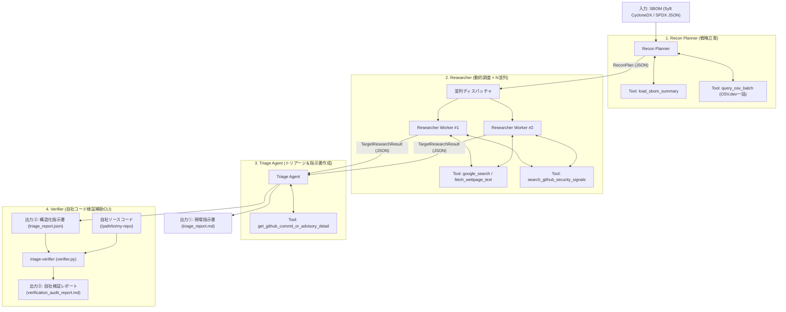

# triage-agent

自社のSBOM（推移的依存を含むライブラリ一覧）を入力として受け取り、LLMエージェントが自律的に巡回・調査・トリアージ・指示書生成を行うマルチエージェントシステムです。

---

## 1. アーキテクチャ概要

本システムは、過剰な独自コードや複雑なフレームワークを排し、Geminiのネイティブな **Function Calling**・**Google Search Grounding**・**Structured Outputs (Pydantic)** を最大限活用した3フェーズの自律型パイプラインです。



### コンポーネント・エージェントの役割
1. **Recon Planner（戦略立案）:** SBOMから推移的依存を解析し、無料・高速な `OSV.dev` 一括照会結果を組み合わせ、攻撃対象領域とRCE傾向から「今すぐ深層調査すべきTop Nコンポーネント」と検索戦略（Pre-announcement事前予告探索を含む）を決定。
2. **Researcher（動的調査）:** GitHub Advisories、直近リリース・RC版、セキュリティ修正コミット、Gemini Google Search Groundingを駆使し、公式パッチ予告や直近シグナルを能動的に調査。
3. **Triage Agent（発火条件特定・指示書作成）:** パッチのコミット差分（Diff）やAdvisory本文を精読し、「どの設定値（`config.xxx = true` 等）が有効な時に発火するか」を特定。CVSSスコア付きの現場即応指示書を出力。
4. **Verifier（補助CLI: 自社コードベース自動検証）:** 指示書内の「確認ポイント（Yes/No）」に基づき、自社リポジトリを自動走査して「自社で本当に発火条件を踏んでいるか」を自動判定し、該当行付きの自社検証結果レポートを出力。

---

## 2. セットアップ

### 必要要件
- Python 3.9+
- Gemini API Key

### インストール
```bash
# 仮想環境の作成と有効化
python3 -m venv .venv
source .venv/bin/activate

# パッケージのインストール
pip install -e .
```

### 環境設定 (`.env`)
`.env.example` をコピーして `.env` を作成します：
```bash
cp .env.example .env
```

```bash
# .env
GEMINI_API_KEY="your-gemini-api-key"

# ベースモデル（環境に合わせて柔軟に切り替え可能）
GEMINI_MODEL="gemini-2.5-flash"

# （任意）役割ごとにモデルを分けたい場合のみ設定
# GEMINI_MODEL_PLANNER="gemini-2.5-pro"
# GEMINI_MODEL_RESEARCHER="gemini-2.5-flash"
# GEMINI_MODEL_TRIAGE="gemini-2.5-pro"

# GitHub Token (任意: GitHub APIのレート制限緩和用)
GITHUB_TOKEN=""
```

---

## 3. 使い方

### 3.1 Syft によるSBOM生成
> 💡 **推奨スキャン手法（コンテナイメージ単位）:**
> `syft scan dir:.` でソースディレクトリのみをスキャンした場合、**Node.js本体、PHPランタイム、OS共有ライブラリ（OpenSSL, Brotli等）** といった基盤層がSBOMに含まれません（例: Brotli脆弱性 CVE-2026-111497 の見落としリスク）。
> 本番環境にデプロイするコンテナイメージ全体をスキャンすることを強く推奨します。

```bash
# 【推奨】コンテナイメージ全体をスキャン (OSパッケージ + ランタイム + アプリ依存を全網羅)
syft scan docker:my-org/my-app:latest -o cyclonedx-json > my_sbom.json
# またはレジストリ直接
syft scan registry:my-org/my-app:latest -o cyclonedx-json > my_sbom.json

# 【簡易】ソースコードディレクトリのみのスキャン (言語ライブラリのみ)
syft scan dir:. -o cyclonedx-json > my_sbom.json
```

### 3.2 トリアージエージェントの実行
```bash
# 基本実行 (Markdownレポートを output_report.md に出力)
python -m triage_agent.cli --sbom my_sbom.json --output output_report.md

# モデルを一時的に変更して実行 (例: flash)
python -m triage_agent.cli --sbom my_sbom.json --model gemini-2.5-flash

# 機械可読なJSON形式で指示書を出力 (verifier との連携用)
python -m triage_agent.cli --sbom my_sbom.json --output triage_report.json
```

### 3.3 自社コードベース自動検証（補助CLI: triage-verifier）
自社でソースコードを保有している場合、指示書内の「確認ポイント」に基づいて自社リポジトリを自動走査し、**「自社で本当に発火条件を踏んでいるか（Yes / No）」の検証結果レポート** を自動生成できます。

```bash
# 1. 補助CLIで自社コードベースを自動検証
python -m triage_agent.verifier --report triage_report.json --code-dir /path/to/my-repo --output verification_audit_report.md

# 2. もしくは triage-agent 実行時にワンライナーで同時実行
python -m triage_agent.cli --sbom my_sbom.json --verify-code /path/to/my-repo
```

生成される検証レポート（[verification_audit_report.md](verification_audit_report.md)）例：
- **総合判定:** `【要対応あり (ACTION REQUIRED)】`
- **urllib3:** `NO (安全)` → 自社コード内に `stream(` や `HTTPS_PROXY` の呼び出しなし（通常リリースで可）
- **jsonwebtoken:** `YES (要対応)` → `server.js:6: return jwt.verify(token, "secret-key")` を自動検知（7日以内の修正推奨）

---

## 4. プロジェクト構成とドキュメント

```text
triage-agent/
├── pyproject.toml            # プロジェクト定義と依存関係
├── .env.example              # 設定テンプレート
├── sample_sbom.json          # 動作確認用Syft CycloneDX SBOM
├── docs/                     # 開発・設計・メンテナンスドキュメント
│   ├── architecture.md       # 全体アーキテクチャ・エージェントトポロジー
│   ├── decision.md           # アーキテクチャ決定記録 (ADR)
│   ├── todo.md               # 今後のロードマップとバックログ
│   └── implementation_plan.md# 初回設計計画書
├── prompts/
│   ├── recon_planner.md      # 戦略立案プロンプト
│   ├── researcher.md         # 動的調査プロンプト
│   └── triage.md             # トリアージ・指示書生成プロンプト
└── src/
    └── triage_agent/
        ├── config.py         # 環境変数・モデル名管理
        ├── schemas.py        # Pydanticデータスキーマ
        ├── cli.py            # メインCLIエントリポイント
        ├── verifier.py       # 自社コードベース自動検証補助CLI
        ├── tools/
        │   ├── sbom.py       # Syft CycloneDX / JSON パーサー
        │   ├── osv.py        # OSV.dev 一括照会 API
        │   ├── github.py     # GitHub Advisories / Commits / Diff 取得
        │   └── web.py        # Webページ本文スクレイパー
        └── agents/
            ├── planner.py    # Recon Planner エージェント
            ├── researcher.py # Researcher エージェント
            └── triage.py     # Triage エージェント
```

### 開発・設計ドキュメント一覧
- [architecture.md](docs/architecture.md): システム設計、エージェント協調モデル、データフロー、ツール仕様
- [decision.md](docs/decision.md): なぜこの言語・SDK・ツール構成・出力フォーマットにしたのかという設計判断記録（ADR）
- [todo.md](docs/todo.md): CI/CD連携やAST構文解析対応など今後の開発ロードマップ
- [implementation_plan.md](docs/implementation_plan.md): 初期開発時の設計計画書
