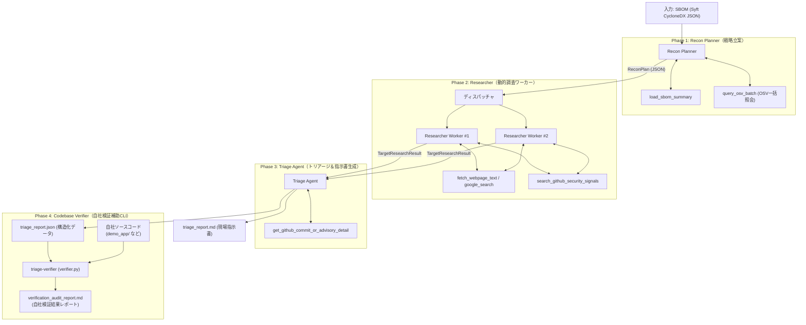
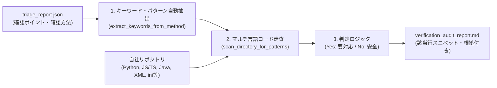

# システムアーキテクチャ設計書 (architecture.md)

本ドキュメントは、`triage-agent` の全体構造、エージェント協調モデル、データフロー、ツールセット、およびモデル構成方針について定義します。

---

## 1. 全体アーキテクチャ概要

本システムは、自社のソフトウェア部品表（SBOM）を起点として、既知の脆弱性（CVE）だけでなく **「パッチのリリース予告」「直近のセキュリティ修正コミット」** を能動的に収集し、**「自社の具体的設定で発火するか」** を解明して即応指示書を出力するマルチエージェントシステムです。

### アーキテクチャ原則
1. **Agent-Native & Minimal Framework:** 複雑なグラフオーケストレータを自作せず、Gemini公式 `google-genai` SDKのFunction CallingとStructured Outputsを中心とした直線的パイプライン構成。
2. **型安全なエージェント間引き継ぎ（Schema Handoff）:** Pydanticモデルを共通言語として各エージェント間でデータをバトンタッチ。
3. **ベンダー問い合わせと自社内製検証の分離・両立:** 
   - 外部委託向けには「Yes/No確認票付きの問い合わせ指示書」を生成。
   - 内製コード向けには「自社リポジトリ自動走査ツール（verifier）」で即座に判定。

---

## 2. マルチエージェントトポロジー

---

## 3. 各エージェントの責務と入出力

| エージェント | 責務 | 入力 | 出力スキーマ | 主なツール |
| :--- | :--- | :--- | :--- | :--- |
| **Recon Planner** | SBOMを全件走査し、OSV一括照会結果と外部露出度から調査優先度（CRITICAL/HIGH）と検索クエリリストを策定 | SBOM JSON, 自社特性（任意） | `ReconPlan` | `load_sbom_summary` `query_osv_batch` |
| **Researcher** | 特定されたターゲットごとに、GitHub Advisories、直近Release/RC、修正コミット、Google検索でシグナルを探索 | `ReconTarget` | `TargetResearchResult` （`ResearchFinding` リスト） | `search_github_security_signals` `fetch_webpage_text` `google_search` |
| **Triage Agent** | 収集したシグナルとパッチ差分（Diff）を精読し、発火する具体的設定値・API利用条件を特定。現場指示書を生成 | `List[TargetResearchResult]` | `TriageReport` （`TriageNotice` リスト） | `get_github_commit_or_advisory_detail` |
| **Verifier (補助CLI)** | 指示書の確認ポイントに基づき、自社コードベース内を走査してYes/Noの自社判定レポートを自動生成 | `TriageReport (JSON)` 自社コードディレクトリ | `CodebaseAuditReport` | `extract_keywords_from_method` `scan_directory_for_patterns` |

---

## 4. ツールセット設計（APIキー・レートリミット対策）

1. **OSV.dev API (`query_osv_batch`):**
   - 無料・認証不要。数千件のパッケージを一括で1リクエスト（`POST /v1/querybatch`）で照会可能。
2. **GitHub API (`search_github_security_signals`, `get_github_commit_or_advisory_detail`):**
   - トークン未設定時は公開IPレートリミット（60回/時）、`GITHUB_TOKEN` 設定時は 5,000回/時。
   - Advisories, Releases, Commits, Diffを一元取得。
3. **Gemini Google Search Grounding (`google_search`):**
   - Gemini APIネイティブのグラウンディング機能。追加のSerpAPI / Tavily等の有料APIキーを不要とし、低コストで事前予告ニュースやブログを検索。

---

## 5. モデル設定とプロンプト分離

- **環境変数外出し:**
  - `GEMINI_MODEL`: デフォルトモデル名（`.env` で設定可能、例: `gemini-2.5-flash`）。
  - `GEMINI_MODEL_PLANNER`, `GEMINI_MODEL_TRIAGE` などの役割別オーバーライドにも対応。
- **プロンプトファイルの分離:**
  - プロンプトはPythonコード内に埋め込まず、`prompts/*.md` にMarkdownとして独立管理。
  - 出力フォーマットは自然言語プロンプトではなく、SDKの `response_schema`（Pydantic）によって100%保証。

---

## 6. 自社コードベース自動検証エンジン (triage-verifier)

`triage-verifier`（[`src/triage_agent/verifier.py`](../src/triage_agent/verifier.py)）は、生成されたトリアージ指示書（`triage_report.json`）を入力として、自社管理下のソースコードリポジトリを自動走査し、**「自社で本当に発火条件を踏んでいるか」** を判定する補助CLIツールです。

### 動作ステップ
1. **パターン抽出（`extract_keywords_from_method`）:**
   - 指示書の `check_point_yes_no` および `verification_method` に含まれるコードトークン（バッククォート囲み、関数呼び出し `stream(`, `jwt.verify`、XMLタグ `<Connector`, `<async-supported`、ini設定 `serialize_handler` 等）を自動抽出。
2. **高速マルチ言語走査（`scan_directory_for_patterns`）:**
   - `.git`, `node_modules`, `.venv`, `dist` 等の非対象ディレクトリを除外し、主要ソースファイル（`.py`, `.js`, `.ts`, `.java`, `.xml`, `.ini`, `.conf` 等）を行単位で走査。
3. **判定と根拠のバインド（`verify_codebase`）:**
   - 発火パターンが検出された場合: `YES (要対応)` と判定し、該当ファイルパス・行番号・コードスニペットを記録。
   - 検出されなかった場合: `NO (安全)` と判定し、「自社コード内では使用されていないため次回定例リリース（30日以内）で可」と結論。
4. **自社検証レポート生成（`format_verification_markdown`）:**
   - 総合判定、項目別判定、検出箇所、推奨回避策を網羅した Markdown レポートを出力。
