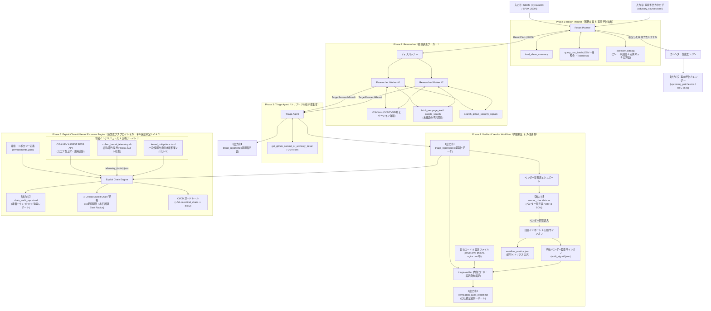
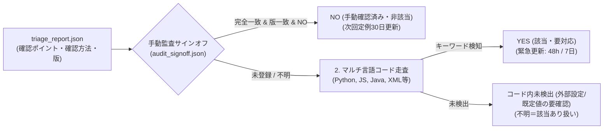
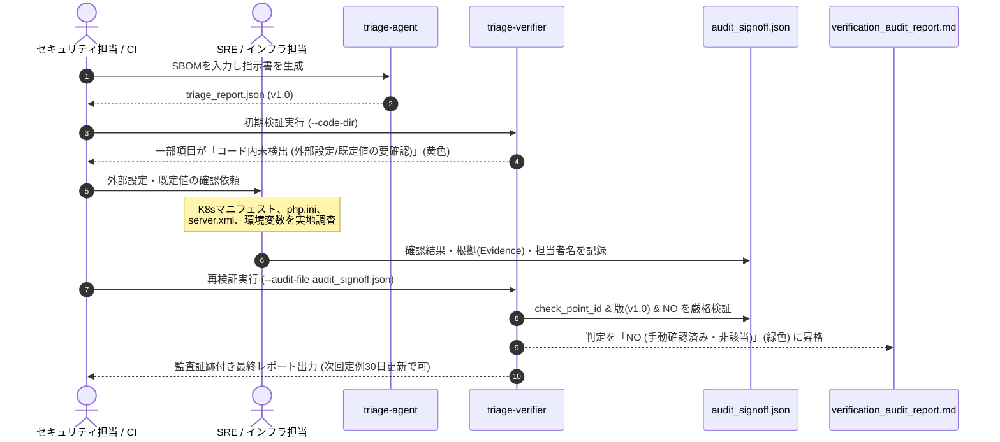
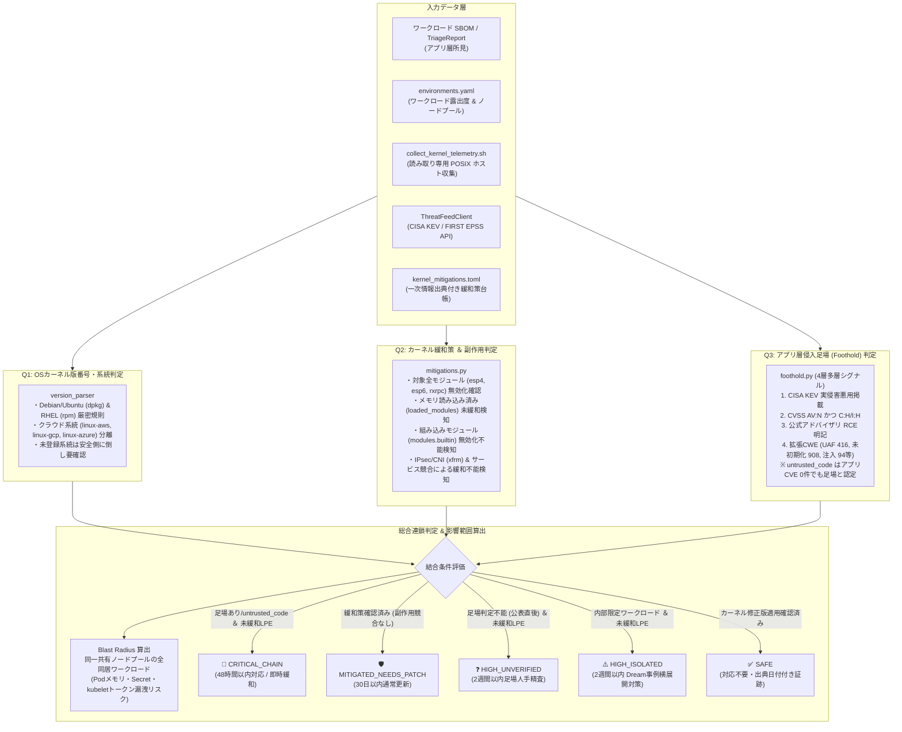

# システムアーキテクチャ設計書 (architecture.md)

本ドキュメントは、`triage-agent` の全体構造、エージェント協調モデル、データフロー、ツールセット、およびモデル構成方針について定義します。

---

## 1. 全体アーキテクチャ概要

本システムは、自社のソフトウェア部品表（SBOM）を起点として、既知の脆弱性（CVE）だけでなく **「パッチのリリース予告」「直近のセキュリティ修正コミット」** を能動的に収集し、**「自社の具体的設定で発火するか」** を解明して即応指示書を出力するマルチエージェントシステムです。

### アーキテクチャ原則
1. **Agent-Native & Minimal Framework:** 複雑なグラフオーケストレータを自作せず、Gemini公式 `google-genai` SDKのFunction CallingとStructured Outputsを中心とした直線的パイプライン構成。
2. **型安全なエージェント間引き継ぎ（Schema Handoff）:** Pydanticモデルを共通言語として各エージェント間でデータをバトンタッチ。
3. **ベンダー問い合わせと自社内製検証の分離・両立:** 
   - 外部委託向けには「Yes/No確認票付きの問い合わせ指示書」を生成。
   - 内製コード向けには「自社リポジトリ自動走査ツール（verifier）」で即座に判定。

---

## 2. マルチエージェントトポロジー



---

## 3. 各エージェントの責務と入出力

| エージェント | 責務 | 入力 | 出力スキーマ | 主なツール / 実行方式 |
| :--- | :--- | :--- | :--- | :--- |
| **Recon Planner** | SBOMを全件走査し、OSV一括照会結果と外部露出度から調査優先度を策定。同時に `advisory_sources.toml` を参照して公式フィード（RSS/Atom）や定例リリース日（Oracle CPU / Patch Tuesday等）から**事前予告イベントを決定論的に抽出**しカレンダー（`.ics`）を生成 | SBOM JSON,<br>`advisory_sources.toml` | `ReconPlan`,<br>事前予告イベントリスト | `load_sbom_summary`<br>`query_osv_batch`<br>`advisory_catalog` (フィード巡回 & 定例日計算)<br>`calendar` (RFC 5545 iCalendar生成) |
| **Researcher** | 特定されたターゲットごとに、Google検索で事前予告・ブログを探索し、OSV.dev / OSV-Scannerの脆弱性シグナルと直近リリース情報を取得した上で2段階推論 | `ReconTarget` | `TargetResearchResult`<br>（`ResearchFinding` リスト） | **2段階実行:**<br>1. `google_search` + OSV.dev<br>2. `response_schema` による構造化合成 |
| **Triage Agent** | 収集したシグナルとパッチ差分（Diff）を精読し、発火する具体的設定値・API利用条件を特定。現場指示書を生成 | `List[TargetResearchResult]` | `TriageReport`<br>（`TriageNotice` リスト） | **2段階実行:**<br>1. Commit Diff & 詳細アドバイザリ取得<br>2. `response_schema` による構造化指示書合成 |
| **Verifier (内製検証)** | 指示書の確認ポイントに基づき、自社リポジトリ内のコード（AST構文木解析・テスト分離）および設定ファイル（Tomcat `server.xml`、PHP `php.ini`、Nginx `nginx.conf` 等）を自動走査。手動監査サインオフと突合 | `TriageReport (JSON)`<br>自社コード & 設定ファイル<br>`AuditAttestation` (任意) | `CodebaseAuditReport` | `config_scanner` (XML/INI/Conf セマンティック解析)<br>`scanner` (AST/コメント完全除去)<br>厳格サインオフ突合（ID・版・NO検証・ドリフト検知） |
| **Vendor Workflow (外注連携)** | 指示書の確認ポイントから Excel / CSV 早見表をワンクリック出力し、ベンダー回答を一括取り込みしてサインオフ確定。ターンアラウンド時間・往復回数を自動集計 | `TriageReport (JSON)`<br>記入済み早見表 CSV | `vendor_checklist.csv`<br>`workflow_metrics.json` | `export_vendor_checklist_csv` (UTF-8 BOM)<br>`import_vendor_checklist_csv`<br>`log_workflow_event` |
| **Exploit Chain & Kernel Exposure (v0.4.0)** | 単体のCVSSスコアにとらわれず、「外部公開/コード実行環境のRCE足場」×「同一共有カーネル上のOS権限昇格（LPE）」の結合リスク、および同一ホスト上の同居マイクロサービスへの水平展開（Blast Radius）を決定論的に判定 | `TriageReport (JSON)`<br>`environments.yaml`<br>実機ノードテレメトリ JSON<br>`kernel_mitigations.toml` | `ChainAuditItem` リスト<br>`chain_audit_report.md` | `audit_exploit_chains`<br>`evaluate_application_foothold`<br>`evaluate_kernel_mitigation`<br>`version_parser` (dpkg / rpm 系統判定)<br>`ThreatFeedClient` (CISA KEV / EPSS急上昇) |

---

## 4. ツールセット設計（完全トークンレス・堅牢性）

1. **OSV.dev API / OSV-Scanner 統合 (`query_osv_batch`):**
   - 無料・認証不要（Tokenless）。数千件のパッケージを一括で1リクエスト（`POST /v1/querybatch`）で照会可能。GitHub Security Advisories (GHSA)、NVD、PyPI、npm、Go、Rust、Maven、Linux等の脆弱性を完全網羅。
   - CLI起動時に1回だけ取得し、プランナーおよびレポートに注入。
2. **完全トークンレス設計（Tokenless Architecture with Public Diff）:**
   - 外部SaaSのトークン漏洩リスクやシークレット管理コストをゼロにするため、`GITHUB_TOKEN` を完全撤廃。
   - パッチコミット差分（Diff）は、OSV レコード内の `references` から特定した公開 `.diff`（認証不要の公開HTTP取得）または Gemini Google Search Grounding で安全に取得。
3. **Gemini Google Search Grounding (`google_search`):**
   - Gemini APIネイティブのグラウンディング機能。追加のSerpAPI / Tavily等の有料APIキーを不要とし、低コストで事前予告ニュースやブログを検索。
4. **2段階実行アーキテクチャ (2-Stage Synthesis):**
   - Gemini APIにおける「カスタムFunction Calling/Search Grounding」と「`response_schema`（Structured Outputs）」の競合（HTTP 400エラー）を回避するため、Stage 1でツール探索（外部検索・Diff取得）を行い、その生コンテキストを渡してStage 2で構造化JSONを確定生成するクリーンな2段階モデルを採用。

---

## 5. モデル設定とプロンプト分離

- **環境変数外出し:**
   - `GEMINI_MODEL`: デフォルトモデル名（`.env` で設定可能、例: `gemini-2.5-flash`）。呼び出しごとに動的評価。
   - `GEMINI_MODEL_PLANNER`, `GEMINI_MODEL_TRIAGE` などの役割別オーバーライドにも対応。
   - Google AI Studio（`GEMINI_API_KEY`）および Google Cloud Vertex AI（`GOOGLE_GENAI_USE_VERTEXAI=true`）の双方を完全サポート。
- **プロンプトファイルの分離:**
   - プロンプトはPythonコード内に埋め込まず、`prompts/*.md` にMarkdownとして独立管理。
   - 出力フォーマットは自然言語プロンプトではなく、SDKの `response_schema`（Pydantic）によって100%保証。

---

## 6. 自社コードベース自動検証エンジン (triage-verifier)

`triage-verifier`（[`src/triage_agent/verifier.py`](../src/triage_agent/verifier.py)）は、生成されたトリアージ指示書（`triage_report.json`）を入力として、自社管理下のソースコードリポジトリを自動走査し、**「自社で本当に発火条件を踏んでいるか」** を判定する補助CLIツールです。



### 3値判定と安全側サインオフ突合設計
1. **3値判定モデル:**
   - `YES (該当・要対応)`: ソースコード内に発火キーワードや危険な関数呼び出し・設定値を検出。
   - `コード内未検出 (外部設定/既定値の要確認)`: ソースコード内には見つからないが、ミドルウェア既定値（デフォルト有効）や外部設定（php.ini, server.xml, 環境変数, コンテナマニフェスト等）の可能性があるため「安全」とは断定せず要確認扱い。
   - `要手動確認`: キーワード抽出不能なインフラ依存の確認項目。
2. **厳格な手動監査サインオフ突合:**
   - **決定論的ハッシュID（順序非依存）:** `check_point_id`（例: `tomcat-demo-cve-2026-0001-338803ee`）は、インデックス（何番目か）やLLMの裁量に任せず、「ターゲット名 + CVE ID + 質問文の正規化テキスト」からSHA-256でツールが自動計算。版の改訂で確認ポイントの並び順が変わっても、同一の確認項目には同一のIDが永久に保たれ、別項目への誤爆を防止。
   - **Notice Fingerprint (`notice_hash`) による自動失効:** お知らせに含まれる確認ポイント集合から指紋ハッシュを算出。第2版でお知らせに新たな確認ポイントが追加・変更された場合、ハッシュが自動的に変化し、手動で版番号を上げなくても古いサインオフは自動失効して再確認対象（黄色）に倒れます。
   - **安全判定の厳格化:** サインオフの `status` が `NO` で始まっている場合のみ安全数（safe_count）として集約し、`YES` やその他が記録されている場合は安全側（要対応）に倒す。
3. **デモデータの完全分離:**
   - 「分からないことを作らない（架空データの捏造防止）」の原則に従い、オフライン時やネットワーク障害時に架空のCVEをでっち上げる処理を全廃。
   - 展示用データは `--demo` フラグにより、明確に `DEMO-*` プレフィックスの付いた安全な合成データとして完全分離。

---

## 7. 監査サインオフ（Audit Sign-off）の運用ワークフロー

外部設定やデフォルト有効に依存する脆弱性について、「未検出＝安全」と安易に判定せず、人間のエンジニアやSREが確認根拠（Evidence）を明記して承認（サインオフ）する実務運用フローは以下の通りです。



### ガバナンス・監査対応（Audit Trail）としての保証
1. **再現性・監査証跡:**
   - 単なる「Yes/No」のフラグではなく、`reviewer`（誰が）、`date`（いつ）、`evidence`（何のドキュメントや設定を見て安全と判断したか）が Markdown レポート内に表形式で永久記録されます。
2. **版更新時の再評価トリガー:**
   - トリアージ指示書に脆弱性の追加や修正があり、Notice の構成が変わった場合（`notice_hash` 不一致）、過去のサインオフは自動失効します。これにより「古い確認結果のまま放置されて新脆弱性を見落とす」運用事故を防ぎます。
3. **正本（Official Baseline）管理による安定運用:**
   - AIは指示書の「下書き（Draft）」を作成する役目に徹し、人間がレビュー・確定してGit管理されたJSONを「その版の正本」として固定化します。
   - `triage-verifier` によるコード走査やサインオフ照合は、常に「正本」に対して行うことで、LLMの表現ブレによるID変化や再確認の手間（疲弊）を完全に排除します。

---

## 7. Engineering Enablement における位置づけと進化像

`triage-agent` は、専門家（セキュリティエンジニア）が都度手作業で行っていた高度な脆弱性分析と判断支援をソフトウェア化し、開発部門や運用委託先自身が迅速に対応を判断・実行できる自律的な組織能力（**Engineering Enablement**）を実現するためのコアコンポーネントです。

### 全社セキュリティ即応サイクル (Enablement Framework)

| フェーズ | 1. Identify (対象特定) | 2. Understand (対応明確化) | 3. Act (対応実行) | 4. Verify (結果検証・証跡) |
| :--- | :--- | :--- | :--- | :--- |
| **担当主体** | 全社SBOM基盤 (Dependency-Track等) | **★ triage-agent** | 現場エンジニア / ベンダー | **★ triage-verifier** |
| **主な役割** | ・網羅的資産照合<br>・機械的既知CVEマッチング | ・多段階自律調査<br>・発火条件特定<br>・**Yes/No 指示書化** | ・迅速な実地確認<br>・設定変更・パッチ適用<br>・チケット/PR連携 | ・自動コード走査<br>・手動/ベンダーサインオフ<br>・改訂時ドリフト自動検知 |
| **提供価値** | 全社横断の可視化 | **専門知識の自動化 (中核強み)** | 自律的な対処実行 | **監査証跡・形骸化防止** |

今後の進化像として、以下の5つの柱を推進します（詳細は [`docs/todo.md`](todo.md) 参照）：
1. **調査スコープの3層階層化:** 全社スキャン基盤（Dependency-Track等）と triage-agent（高度深層トリアージ）の明確な役割分担。
2. **コンテキスト付きサインオフ:** 環境（Staging/Prod）・構成版・有効期限（TTL）をサインオフに紐付け。
3. **システム構成プロファイル（組織知化 & 偵察防止）:** ベンダーや現場の回答から「システムの恒久的構成事実（AJP無効等）」を辞書化し次回の重複照会を自動解決。同時に、侵入経路の事前偵察情報として悪用されないよう機密情報（Confidential）として厳格管理。
4. **ライフサイクルMTTR計測:** 検知から対応完了までのタイムスタンプを自動計測し、削減時間・ROIを定量化。
5. **成果物の機密性管理と攻撃地図化の防止:** 成果物のTTLパージ、システム別レポート分割、48時間ルールによる賞味期限短縮。

### システム境界（個別実行エンジンと集中管理ハブ）
本アーキテクチャでは、「単一システム・単一SBOMに対する深層トリアージとコード検証を行うコアエンジン（`triage-agent`）」と、「部門全体の複数SBOM・複数システムのトリアージ状況を横断集約する集中管理UI（`triage-hub` / 別リポジトリ構想）」の責務境界を明確に分離しています。`triage-agent` がポータブルな標準JSON（`triage_report.json` / `audit_signoff.json`）を出力することで、将来的な集中ダッシュボードへのデータ連携を疎結合に実現します。

なお、全システムの未対応脆弱性がHubに集約されて「全社攻撃地図」と化すリスクを防ぐため、Hubへの連携は件数やステータス等の高位メタデータのみとする **Zero-Detail Federation 原則** を採用し、具体的なファイルパスやコード行情報は各システム側に分散保持させます。また、全社横断CVE影響検索は厳格なアクセス制御（RBAC）と監査ログ（Audit Logging）の対象とします。詳細は [`docs/todo.md`](todo.md) を参照してください。

---

## 8. 連鎖エクスプロイト（Exploit Chain）＆ Linux カーネル露出追跡 (v0.4.0)

2026年10月の Fragnesia（CVE-2026-46300）および PHP2Shell（CVE-2026-109618/109619）事件の教訓に基づき、**「単一脆弱性のCVSS値にとらわれず、システム環境全体での結合リスクと水平展開被害を決定論的に判定する」** エンジンを新設しました。



### コア設計原則（安全側倒し ＆ 誤認防止）
1. **分からないものを安全と言わない（Fail-Safe Verification）:**
   - クラウド向けカーネル（例: `linux-aws`）で台帳に当該系統の版番号が未登録の場合、汎用の版番号と比較して「修正済み」と断定することを禁止。
   - 公表直後で CVSS/CWE が未整備の脆弱性は「足場なし」と断定せず、`HIGH_UNVERIFIED`（要人手確認）に倒す。
   - テレメトリ未取得のホストは、安全側に倒して「未緩和」として扱う。
2. **作った内容を本物に見せない（Synthetics Separation）:**
   - 特定の CVE 番号をエンジン内に固定値ハードコードすることを完全禁止。
   - 見本ファイル（[exploit_chain_ledger.example.json](../exploit_chain_ledger.example.json)）には架空の `CVE-0000-00000` を明記。
3. **攻撃地図化の防止（Confidential Attack Map Protection）:**
   - 実環境の `environments.yaml`、ノードテレメトリ JSON、および `chain_audit_report.md` は `.gitignore` でリポジトリへのコミットを防止。
   - ホスト名収集はオプトインとし、デフォルトでは `anonymized-node` として匿名化。
4. **横展開・共有カーネル境界の死角排除（Dream 事例の教訓）:**
   - 外部公開されていない内部マイクロサービスであっても、共有カーネルノードプール上で動く以上、同居 Pod 侵害からのコンテナ脱出・node root 奪取により全ワークロードの Secret や kubelet 認証情報が漏洩します。内部ノードに対しても「2週間以内対応（定期メンテ先送り禁止）」の厳格な期限を課します。

---

## 9. プロジェクトディレクトリ構成

```text
triage-agent/
├── pyproject.toml            # パッケージ定義・CLIエントリポイント
├── .env.example              # 設定テンプレート
├── sample_sbom.json          # 動作確認用 Syft CycloneDX SBOM
├── docs/                     # 詳細設計・運用ドキュメント
│   ├── architecture.md       # 全体アーキテクチャ・エージェントトポロジー
│   ├── setup.md              # インストールと環境設定
│   ├── usage.md              # CLI & Web GUI 利用ガイド
│   ├── verifier.md           # 内製コード＆設定自動検証
│   ├── signoff.md            # 監査サインオフと正本管理運用
│   ├── early-warning-calendar.md # 事前予告カレンダーと監視先
│   ├── exploit-chain.md      # 連鎖エクスプロイト＆カーネル露出監査
│   ├── vendor-workflow.md    # ベンダー往復と対応時間計測
│   ├── benchmark.md          # グラウンドトゥルース評価セット
│   ├── self-triage.md        # 自己診断と「3つの鮮度」
│   ├── decision.md           # アーキテクチャ決定記録 (ADR)
│   └── todo.md               # 今後のロードマップ
├── scripts/
│   ├── collect_kernel_telemetry.sh # ホスト実機テレメトリ収集（POSIX sh）
│   └── self_triage.sh              # 自己診断ワンライナー
├── benchmark/                # グラウンドトゥルース評価データセット
│   ├── manifest.json         # 評価ケース定義
│   ├── cases/                # 陽性ケース
│   ├── cases_negative/       # 陰性ケース
│   ├── cases_hard/           # 難関設定上書きケース
│   └── feeds/                # 事前予告フィード実例
└── src/
    └── triage_agent/
        ├── cli.py            # メインCLIエントリポイント
        ├── benchmark.py      # ベンチマークランナー
        ├── pipeline.py       # 共有パイプライン実行コア
        ├── web_ui.py         # Web GUI エントリポイント
        ├── chain/            # 連鎖エクスプロイト監査エンジン (v0.4.0)
        │   ├── engine.py     # 連鎖判定コア＆レポート生成
        │   ├── foothold.py   # アプリ層侵入足場（RCE）多層判定
        │   ├── mitigations.py# カーネル緩和策＆副作用判定
        │   ├── feeds.py      # CISA KEV / FIRST EPSS / OSV クライアント
        │   ├── models.py     # データモデル定義
        │   └── version_parser.py # ディストリビューション版番号照合
        ├── verifier/         # 自社コードベース自動検証エンジン
        │   ├── engine.py     # 検証コア
        │   ├── scanner.py    # AST構文解析・テストコード分離
        │   ├── config_scanner.py # 設定ファイル走査
        │   └── attestation.py# サインオフ突合＆ドリフト検知
        ├── tools/            # エージェント用ツール群
        ├── agents/           # LLMエージェント定義
        ├── data/             # 定義データ（advisory_sources.toml等）
        └── ui/               # Web GUI パッケージ（HTML/CSS/JS/Server）
```


