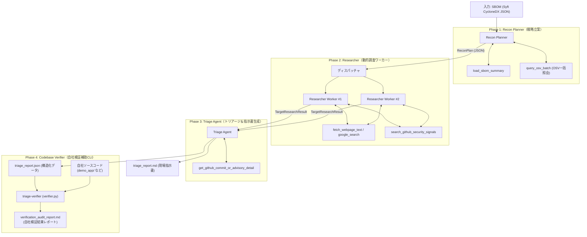
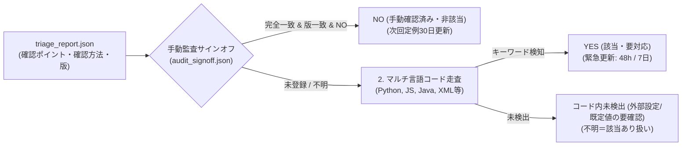
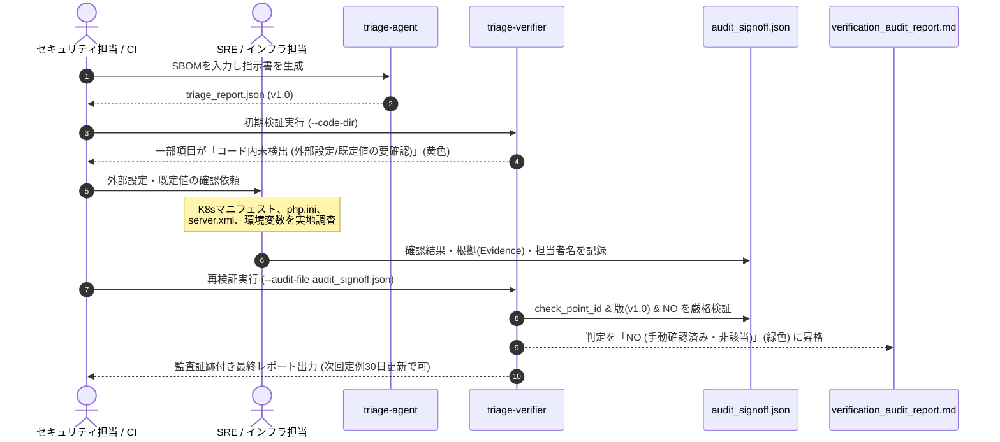

# システムアーキテクチャ設計書 (architecture.md)

本ドキュメントは、`triage-agent` の全体構造、エージェント協調モデル、データフロー、ツールセット、およびモデル構成方針について定義します。

---

## 1. 全体アーキテクチャ概要

本システムは、自社のソフトウェア部品表（SBOM）を起点として、既知の脆弱性（CVE）だけでなく **「パッチのリリース予告」「直近のセキュリティ修正コミット」** を能動的に収集し、**「自社の具体的設定で発火するか」** を解明して即応指示書を出力するマルチエージェントシステムです。

### アーキテクチャ原則
1. **Agent-Native & Minimal Framework:** 複雑なグラフオーケストレータを自作せず、Gemini公式 `google-genai` SDKのFunction CallingとStructured Outputsを中心とした直線的パイプライン構成。
2. **型安全なエージェント間引き継ぎ（Schema Handoff）:** Pydanticモデルを共通言語として各エージェント間でデータをバトンタッチ。
3. **ベンダー問い合わせと自社内製検証の分離・両立:** 
   - 外部委託向けには「Yes/No確認票付きの問い合わせ指示書」を生成。
   - 内製コード向けには「自社リポジトリ自動走査ツール（verifier）」で即座に判定。

---

## 2. マルチエージェントトポロジー

---

## 3. 各エージェントの責務と入出力

| エージェント | 責務 | 入力 | 出力スキーマ | 主なツール / 実行方式 |
| :--- | :--- | :--- | :--- | :--- |
| **Recon Planner** | SBOMを全件走査し、OSV一括照会結果と外部露出度から調査優先度（CRITICAL/HIGH）と検索クエリリストを策定 | SBOM JSON, 自社特性（任意） | `ReconPlan` | `load_sbom_summary` `query_osv_batch` (CLI側で1回取得して注入) |
| **Researcher** | 特定されたターゲットごとに、Google検索で事前予告・ブログを探索し、GitHub Advisories、直近Release/RC、修正コミットを取得した上で2段階推論 | `ReconTarget` | `TargetResearchResult` （`ResearchFinding` リスト） | **2段階実行:** 1. `google_search` + GitHub API 2. `response_schema` による構造化合成 |
| **Triage Agent** | 収集したシグナルとパッチ差分（Diff）を精読し、発火する具体的設定値・API利用条件を特定。現場指示書を生成 | `List[TargetResearchResult]` | `TriageReport` （`TriageNotice` リスト） | **2段階実行:** 1. Commit Diff & 詳細アドバイザリ取得 2. `response_schema` による構造化指示書合成 |
| **Verifier (補助CLI)** | 指示書の確認ポイントに基づき、自社コードベース内を走査してYes/Noの自社判定レポートを自動生成。手動監査サインオフ突合に対応 | `TriageReport (JSON)` 自社コードディレクトリ `AuditAttestation` (任意) | `CodebaseAuditReport` | `extract_keywords_from_method` `scan_directory_for_patterns` 厳格サインオフ突合（ID・版・NO検証） |

---

## 4. ツールセット設計（APIキー・レートリミット対策・堅牢性）

1. **OSV.dev API (`query_osv_batch`):**
   - 無料・認証不要。数千件のパッケージを一括で1リクエスト（`POST /v1/querybatch`）で照会可能。CLI起動時に1回だけ取得し、プランナーおよびレポートに注入。
2. **GitHub API (`search_github_security_signals`, `get_github_commit_or_advisory_detail`):**
   - トークン未設定時は公開IPレートリミット（60回/時）、`GITHUB_TOKEN` 設定時は 5,000回/時。
   - Advisories, Releases, Commits, Diffを一元取得。403/429レート制限等の非200応答は例外を飲み込まず `errors` に記録し、レポート警告に集約。
3. **Gemini Google Search Grounding (`google_search`):**
   - Gemini APIネイティブのグラウンディング機能。追加のSerpAPI / Tavily等の有料APIキーを不要とし、低コストで事前予告ニュースやブログを検索。
4. **2段階実行アーキテクチャ (2-Stage Synthesis):**
   - Gemini APIにおける「カスタムFunction Calling/Search Grounding」と「`response_schema`（Structured Outputs）」の競合（HTTP 400エラー）を回避するため、Stage 1でツール探索（外部検索・Diff取得）を行い、その生コンテキストを渡してStage 2で構造化JSONを確定生成するクリーンな2段階モデルを採用。

---

## 5. モデル設定とプロンプト分離

- **環境変数外出し:**
   - `GEMINI_MODEL`: デフォルトモデル名（`.env` で設定可能、例: `gemini-2.5-flash`）。呼び出しごとに動的評価。
   - `GEMINI_MODEL_PLANNER`, `GEMINI_MODEL_TRIAGE` などの役割別オーバーライドにも対応。
   - Google AI Studio（`GEMINI_API_KEY`）および Google Cloud Vertex AI（`GOOGLE_GENAI_USE_VERTEXAI=true`）の双方を完全サポート。
- **プロンプトファイルの分離:**
   - プロンプトはPythonコード内に埋め込まず、`prompts/*.md` にMarkdownとして独立管理。
   - 出力フォーマットは自然言語プロンプトではなく、SDKの `response_schema`（Pydantic）によって100%保証。

---

## 6. 自社コードベース自動検証エンジン (triage-verifier)

`triage-verifier`（[`src/triage_agent/verifier.py`](../src/triage_agent/verifier.py)）は、生成されたトリアージ指示書（`triage_report.json`）を入力として、自社管理下のソースコードリポジトリを自動走査し、**「自社で本当に発火条件を踏んでいるか」** を判定する補助CLIツールです。

### 3値判定と安全側サインオフ突合設計
1. **3値判定モデル:**
   - `YES (該当・要対応)`: ソースコード内に発火キーワードや危険な関数呼び出し・設定値を検出。
   - `コード内未検出 (外部設定/既定値の要確認)`: ソースコード内には見つからないが、ミドルウェア既定値（デフォルト有効）や外部設定（php.ini, server.xml, 環境変数, コンテナマニフェスト等）の可能性があるため「安全」とは断定せず要確認扱い。
   - `要手動確認`: キーワード抽出不能なインフラ依存の確認項目。
2. **厳格な手動監査サインオフ突合:**
   - **完全一致の原則:** `check_point_id`（例: `urllib3-cve-2026-97687-cp1`）または `(cve_id, check_point_yes_no)` による完全一致のみを認める。文字列の部分一致（`CVE-2026-11149` が `CVE-2026-111497` に誤爆する問題）やCVE単位での全項目一括安全判定を完全に防止。
   - **レポート版（`report_version`）の検証:** サインオフ時の版と現在のレポート版が異なる場合、早見表の更新に伴う見落としを防ぐためサインオフを自動的に無効化し再確認を促す。
   - **安全判定の厳格化:** サインオフの `status` が `NO` で始まっている場合のみ安全数（safe_count）として集約し、`YES` やその他が記録されている場合は安全側（要対応）に倒す。

---

## 7. 監査サインオフ（Audit Sign-off）の運用ワークフロー

外部設定やデフォルト有効に依存する脆弱性について、「未検出＝安全」と安易に判定せず、人間のエンジニアやSREが確認根拠（Evidence）を明記して承認（サインオフ）する実務運用フローは以下の通りです。

### ガバナンス・監査対応（Audit Trail）としての保証
1. **再現性・監査証跡:**
   - 単なる「Yes/No」のフラグではなく、`reviewer`（誰が）、`date`（いつ）、`evidence`（何のドキュメントや設定を見て安全と判断したか）が Markdown レポート内に表形式で永久記録されます。
2. **版更新時の再評価トリガー:**
   - トリアージ指示書に脆弱性の追加や修正があり `report_version` が上がった場合、過去のサインオフは自動失効します。これにより「古い確認結果のまま放置されて新脆弱性を見落とす」運用事故を防ぎます。
