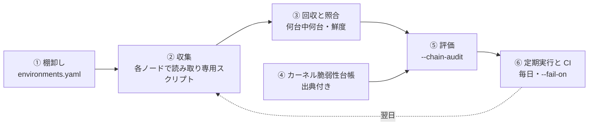

# 連鎖エクスプロイト＆ Linux カーネル露出監査 (Exploit Chain Engine)

単一の脆弱性の CVSS 値（例: 7.8）にとらわれず、**「外部公開・コード実行環境（RCE足場）」×「同一ホスト上の未解消OSカーネルLPE（権限昇格）」** の結合リスク、および同一共有ノードプールに同居する別マイクロサービスへの **水平展開（Blast Radius / Lateral Movement）** を決定論的に判定する監査エンジン（v0.4.0 / ADR-019）です。

> 💡 **まず「うちのサーバーに、悪用されているカーネルの脆弱性が残っていないか」だけを確かめたい場合は、** この文書の手順（環境定義・全ノードからの収集・定期実行）は要りません。開発ベンダーに各サーバーのカーネルの版を聞くだけで、残っているものと更新してほしい版が分かります（`--kernel-inquiry`。[使い方](usage.md#カーネル脆弱性の問い合わせ--kernel-inquiry)）。この文書は、足場との組み合わせまで評価し、毎日見張る場合の手順です。

---

## 1. なぜ連鎖エクスプロイト監査なのか

コンテナ環境（Kubernetes や ECS）において、コンテナはホスト OS のカーネルを共有しています。
1. **アプリ層の脆弱性**: 外部公開された Web アプリ等で RCE（任意コード実行）が発生すると、攻撃者はまずコンテナ内の一般権限（足場）を獲得します。
2. **カーネル層の脆弱性**: 同一ノードの Linux カーネルに未解消の LPE（局所権限昇格）が存在すると、攻撃者はコンテナを脱出してノード全体の root 権限を奪取します。
3. **水平展開（Blast Radius）**: ノード root を奪取された時点で、同一ノードで稼働する**他の全 Pod のメモリ、環境変数、マウントされた Secret、および kubelet 認証トークンがすべて奪取**され、クラスタ全体への侵害へと直結します。

コンテナに限らず、1 台の仮想マシンや物理サーバで複数のサービスを動かしている場合も同じです。どれか 1 つのサービスが足場になれば、同じカーネルの上にある他のサービスまで届きます。本ドキュメントでは、カーネルを共有する単位（Kubernetes のノード、同じ構成の仮想マシン群など）を「ノードプール」と呼びます。

単体では「ローカル攻撃限定（AV:L）だから後回し」と判断されがちなカーネル LPE を、足場との共存関係から **Critical（48時間以内対応）** として引き上げます。

---

## 2. 判定の4つの柱

1. **多層シグナル足場判定**:
   - CISA KEV 実侵害掲載
   - CVSS メトリクス合致（`AV:N` かつ `C:H/I:H`）
   - 公式要約における任意コード実行（Remote Code Execution）の明記
   - 拡張 CWE（UAF 416, 未初期化 908, 注入 94, デシリアライズ 502 等）の検知
   - `untrusted_code`（CI ランナー環境）はアプリ CVE 0件でも足場として Critical を発火
2. **クラウドカーネル系統の識別**:
   - AWS（`linux-aws`）、GCP（`linux-gcp`）、Azure（`linux-azure`）などのフレーバーを厳密に区別。
   - 台帳にクラウド専用の修正版がない場合は、汎用 Ubuntu の版番号で「修正済み」と誤認することを禁止し、「要確認」として安全側に倒します。
3. **実機テレメトリ検証 (`scripts/collect_kernel_telemetry.sh`)**:
   - `install /bin/false` 設定だけでなく、`/proc/modules` 内にモジュールが現在読み込まれていないか（再起動必要か）、IPsec / CNI（xfrm）の稼働による緩和副作用（通信切断）がないかを厳格判定。
4. **横展開・Blast Radius 可視化**:
   - 内部限定ワークロードに対しても「2週間以内対応（定期メンテ先送り禁止）」の厳格な期限を課します。

---

## 3. 全体の流れ

連鎖評価は「1 台で 1 回動かす」ものではなく、**ノードプールごとに全ノードの実機情報を集め、定期的に評価し直す**ことを前提にしています。全体は次の 6 段です。



| 段 | やること | 主な入出力 |
| :--- | :--- | :--- |
| ① 棚卸し | ノードプール（カーネルを共有する単位）と、そこで動くワークロードの露出度を書く | `environments.yaml` |
| ② 収集 | プールの全ノードで収集スクリプトを実行する | `telemetry/<プール>/node-NNN.json` |
| ③ 回収と照合 | 何台中何台集まったか、古すぎないかを確かめる | `collection_manifest.json` |
| ④ 台帳 | 評価対象のカーネル脆弱性（LPE）を出典付きで用意する | `exploit_chain_ledger.json` |
| ⑤ 評価 | 足場（RCE）と未解消の LPE の組み合わせを判定する | `chain_audit_report.md` |
| ⑥ 定期実行と CI | 毎日実行し、致命的な連鎖が出たら止める | 終了コード 2 |

---

## 4. 実行手順

### ① 棚卸し: 環境定義を書く

[`environments.example.yaml`](../environments.example.yaml) を `triage-output/environments.yaml` にコピーして書き換えます（`triage-output/` は `.gitignore` 対象です）。

- **ノードプール（`node_pools`）**: カーネルを共有する単位ごとに 1 つ書きます。`id` は収集時の `-p` と一致させます。
  - **`nodes` または `nodes_count` を必ず書いてください。** プールの「期待ノード数」になり、一部のノードしか集まっていないことを検出する根拠になります（収集マニフェストがあればそちらが優先されます）。
  - OS やカーネル版は、実機テレメトリがあればそちらが正として使われます。環境定義の値は、テレメトリがないプールの評価にだけ使われます（レポートには「構成定義上（実機未確認）」と出ます）。
- **ワークロード（`workloads`）**: プールで動くサービスと、その露出度（`internet_facing` / `untrusted_code` / `internal_only`）を書きます。分からない場合は書かなければ `internet_facing` として安全側に扱われます。

### ② 収集: 全ノードでテレメトリを集める

各ノードで [`scripts/collect_kernel_telemetry.sh`](../scripts/collect_kernel_telemetry.sh) を実行します。POSIX sh だけで動き、読み取り専用でノードを変更しません。`-p` にはプール ID を指定します（必須）。

```bash
# 1 台だけ、その場で実行する場合
sh scripts/collect_kernel_telemetry.sh -p dmz-pool -o triage-output/telemetry/dmz-pool/node-001.json
```

複数台から集めるときは、基盤に合わせて次の補助スクリプト（`scripts/collect/`）を使います。どれも、プールの全ノードに収集スクリプトを配り、結果を `triage-output/telemetry/<プール>/node-NNN.json` に保存し、最後に**収集マニフェスト**を書きます。ファイル名にホスト名は入りません。

| 基盤 | 補助スクリプト | プールの指定方法 |
| :--- | :--- | :--- |
| ssh で入れるホスト（クラウドの VM、オンプレミス、物理サーバ） | `collect_via_ssh.sh` | ホスト一覧のファイル（`-H`） |
| Kubernetes（マネージドかどうかを問わない） | `collect_via_kubectl.sh` | ノードのラベルセレクタ（`-l`） |
| AWS の EC2（Systems Manager 経由） | `collect_via_ssm.sh` | EC2 のフィルタ（`-f`） |

```bash
# ssh: ホスト一覧は 1 行に 1 台（Ansible なら `ansible <group> --list-hosts` から作れます）
sh scripts/collect/collect_via_ssh.sh -p dmz-pool -H hosts/dmz-pool.txt

# Kubernetes: プールのノードを選ぶラベルは基盤ごとに違います（例は EKS / GKE / AKS）
sh scripts/collect/collect_via_kubectl.sh -p dmz-pool -l eks.amazonaws.com/nodegroup=dmz
sh scripts/collect/collect_via_kubectl.sh -p dmz-pool -l cloud.google.com/gke-nodepool=dmz
sh scripts/collect/collect_via_kubectl.sh -p dmz-pool -l kubernetes.azure.com/agentpool=dmz

# AWS SSM: 実行中のインスタンスのうち、フィルタに合うものすべてが対象です
sh scripts/collect/collect_via_ssm.sh -p dmz-pool -f "Name=tag:triage-pool,Values=dmz"
```

上記にない基盤（他のクラウドのリモート実行、構成管理ツールなど）でも、収集スクリプトの標準出力を `node-NNN.json` として保存し、下の形式の収集マニフェストを書けば同じように扱えます。

各スクリプトの注意点:

- **ssh**: 接続できなかったホスト（ssh の終了コード 255）は「届かなかった」、スクリプトが失敗したり出力が壊れていたホストは「失敗」として記録されます。
- **kubectl**: `kubectl debug node/...` で `sysadmin` プロファイルのデバッグ Pod を作り、`chroot /host` でノード自身の `/bin/sh` を使って実行します。デバッグ Pod は終わるたびに削除します（`-k` で残せます）。Ready でないノードは「届かなかった」になります。ノードに `/bin/sh` がない OS（Bottlerocket など）では失敗として記録されます。
- **AWS SSM**: Systems Manager にオンラインでないインスタンスも、対象から外さずに「届かなかった」として記録します。収集スクリプトは base64 でコマンドに埋め込んで `sh` に渡すため、インスタンスにファイルは書かれません。Run Command の履歴には、プール ID とソルトを含むコマンドが残ります。

**ノード ID とソルト**: 収集スクリプトはホスト名を出力せず、`/etc/machine-id`（取れなければホスト名）と組織ソルトのハッシュから、ホストごとに安定した匿名 ID（例: `node-7b8174c4e65c`）を出します。ソルトは `-s` か環境変数 `TRIAGE_NODE_ID_SALT` で指定してください。同じホストを二重に集めても 1 台として数えられます。

### ③ 回収と照合: 何台中何台集まったか

補助スクリプトは、プールのディレクトリに次のような `collection_manifest.json` を書きます。`targets` の件数がそのプールの期待ノード数として使われ、`environments.yaml` の `nodes` より優先されます。オートスケーリングでノードが入れ替わる環境でも、その時点で実在したノードの数で判定できます。

```json
{
  "kind": "collection_manifest",
  "pool_id": "dmz-pool",
  "method": "ssh",
  "generated_at": "2026-11-02T00:00:00Z",
  "targets": ["web-01", "web-02", "web-03"],
  "succeeded": ["web-01", "web-02"],
  "failed": [],
  "unreachable": ["web-03"]
}
```

マニフェストには、ノードに到達するために使った識別子（ホスト名、Kubernetes のノード名、インスタンス ID）がそのまま入ります。`triage-output/` の外に持ち出さないでください。

監査はテレメトリを読み込むときに次を確かめ、結果をレポート冒頭の「実機テレメトリの収集状況」に出します。

| 確認内容 | 扱い |
| :--- | :--- |
| 期待ノード数に満たないプール | 未収集のノードに古いカーネルが残っている可能性があるため、「修正済み（SAFE）」「緩和済み」と判定せず要確認にします |
| 期待ノード数が分からないプール | 判定は行いますが「期待ノード数不明」と明記します |
| 収集から日数が経ったテレメトリ | `--telemetry-max-age`（既定 7 日、0 で無効）を超えたものは根拠から除外します |
| `pool_id` がないテレメトリ | 除外して警告します |
| テレメトリと環境定義のプール ID の不一致 | 両方向とも警告します |

### ④ カーネル脆弱性台帳を用意する

評価対象のカーネル脆弱性（LPE）は、[`exploit_chain_ledger.example.json`](../exploit_chain_ledger.example.json) の形式で `triage-output/exploit_chain_ledger.json` に書きます。

修正版のバージョンは、ディストリビューションとカーネルの系統（フレーバー）ごとに正確である必要があるため、公式アドバイザリに基づき、出典付き（`source_url` と `retrieved_at` が必須）で管理します。出典のないエントリは、推測データによる誤判定を防ぐため読み飛ばされ、警告が出ます。

#### 自動照会（`--kernel-auto`）: 台帳に載っていない LPE を横展開で見つける

`--kernel-auto` を付けると、各ノードプールで実際に動いているカーネルの版を、ディストリの勧告と突き合わせ、まだ修正されていない脆弱性を自動で引きます。見つかった脆弱性は次の 3 層に分けます。

| 層 | 条件 | 扱い |
| :--- | :--- | :--- |
| 層 1 | CISA KEV に掲載（実際に悪用されている）、または**昇格**した（下記） | 手動台帳と同じく連鎖評価にかけます（足場があれば `CRITICAL_CHAIN`） |
| 層 2 | EPSS が `--kernel-auto-epss`（既定 0.1）以上、またはディストリの重大度が critical | 連鎖評価にかけますが、上限は `HIGH_UNVERIFIED`（2 週間・人による確認）です。プールごとに上位 `--kernel-auto-tier2-limit`（既定 10）件まで |
| 層 3 | 上記以外 | 件数だけを示します |

レポートの「カーネル脆弱性の自動照会（横展開）」には、プールごとに各層の件数と、**「この版まで上げれば層 1・2 が全部解消する」版**が出ます。カーネルは個別に直すものではなく更新でまとめて直すものなので、まずこの版を見てください。

- **対応しているディストリ**: 照会元は [`src/triage_agent/chain/kernel_sources.toml`](../src/triage_agent/chain/kernel_sources.toml) に登録したアダプタで決まります。現在は Amazon Linux 2023 / 2、Ubuntu、Debian、AlmaLinux、Rocky Linux、RHEL 8 / 9 / 10 に対応しています。ディストリごとの照会元と既知の制約（修正版がまだない CVE が見えるか、livepatch の扱い、EUS など）は [ディストリ対応表](kernel-sources.md) を見てください。対応していないディストリは「照会元なし」と表示し、手動台帳だけで評価します。新しいディストリへの対応は、同じページの手引きに沿って Pull Request でお寄せください。

  OSV の照会結果は `triage-output/cache/osv/` に 24 時間キャッシュし、レコードは更新されたものだけを取り直します。OSV は知らないパッケージにも「該当なし」と答えるため、1 件も返らなかった場合はそのパッケージの記録があるかを確かめ、記録がなければ「照会不全」とします（「未修正なし」とは扱いません）。初回は EPSS の照会（CVE 50 件ずつ）に数分かかることがあります。
- **修正版なし**: ディストリがまだ修正版を出していない脆弱性は、レポートで「修正版なし」と示します。カーネルを更新しても解消しないため、緩和策を検討してください。連鎖評価では「要確認」（該当の可能性あり）として扱います。
- **照会元がないディストリ**: 「照会元なし（手動台帳のみ）」と明示し、手動台帳だけで評価します。自動照会できなかったプールを「脆弱性なし」とは扱いません。
- **カーネルの系統**: 系統は「パッケージ名＋上流の系列」で区別します（例: Amazon Linux 2023 の `kernel`（6.1）と `kernel6.12`、Amazon Linux 2 の `kernel` 4.14 と 5.10）。別の系統の修正版で「修正済み」と判定することはありません。
- **livepatch**: 実行中のカーネルのビルドに対応する livepatch パッケージが入っていて、その版が勧告の版以上なら、その脆弱性は「livepatch で解消」として数えます。
- **手動台帳が優先**: 同じ CVE が手動台帳にある場合は、出典付きの手動台帳の内容を使います。
- **前回からの変化と昇格**: 毎回の結果を `triage-output/kernel_auto/snapshot.json` に保存し、次の実行で比べます（⑥ を参照）。
- **CVSS**: 自動照会で見つかった CVE の CVSS は、Red Hat Security Data API から一括で取得します（カーネルの CVE 約 2 万件、24 時間キャッシュ）。ディストリを問わず、層の中の並び順と、昇格（採点の引き上げ）の判定に使います。採点は Red Hat の評価で、NVD とはベクトルが一致しないことも多いため、レポートには採点元を明記します。LPE 型の CVSS であること自体は層 2 の条件にしていません（カーネルの CVE の 1〜3 割が当てはまり、層 2 が数百件になるため）。照会元は `kernel_sources.toml` の `[signals.cvss]` で差し替えられます。
- **Amazon Linux の注意**: ALAS の重大度は勧告単位で、1 件の勧告に数十件の CVE がまとまっているため、層の判定には KEV と EPSS を主に使っています。また ALAS は修正版が出た CVE だけを載せるため、「修正版がまだない脆弱性」は自動照会では見えません。
- **必要な実機情報**: 収集スクリプト（この版以降）が出す `kernel_package_epoch`・`kernel_binary_package`・`livepatch_packages` を使います。古い収集スクリプトのテレメトリでは、epoch が分からず比較できない脆弱性が「判定不能」として数えられます。
- **KEV カタログの確認**: CISA KEV のカタログは、版・公開日・件数が揃った本物の形式のものだけを使います（キャッシュも同じです）。レポートには、使ったカタログの版・公開日・件数を出します。件数が極端に少ないなど、おかしいと感じたら `triage-output/cache/cisa_kev_catalog.json` を削除して取り直してください。
- **通信**: 勧告メタデータは公開リポジトリから取得するだけで、こちらから送る情報はありません。CVE 番号は KEV・EPSS の照会に使います（[データの取り扱い](data-handling.md)）。`--dry-run` ではキャッシュだけを使います。

### ⑤ 評価する

```bash
python -m triage_agent.cli --chain-audit \
  --environments triage-output/environments.yaml \
  --chain-ledger triage-output/exploit_chain_ledger.json \
  --telemetry triage-output/telemetry/ \
  --telemetry-max-age 7 \
  --kernel-auto \
  --chain-output triage-output/chain_audit_report.md
```

レポートの判定は次のとおりです。

| 判定 | 意味 | 対応期限 |
| :--- | :--- | :--- |
| `CRITICAL_CHAIN` | 外部から届く足場（RCE、または信頼できないコードの実行環境）と、同じカーネル上の未解消 LPE が揃っている | 48 時間以内（緩和策の即時適用） |
| `HIGH_UNVERIFIED` | 足場になりうるかを自動で判定できない脆弱性と、未解消 LPE が揃っている | 2 週間以内（人による確認） |
| `HIGH_ISOLATED` | 足場は見つかっていないが、未解消 LPE がある（内部限定でも横展開の起点になる） | 2 週間以内 |
| `MITIGATED_NEEDS_PATCH` | 緩和策が確認できたが、パッチは未適用（一部のノードしか集まっていないプールでは出ません） | 30 日以内 |
| `SAFE` | 修正済みのカーネルが確認できた（一部のノードしか集まっていないプールでは出ません） | 対応不要 |

どの判定も、構成と版から見て「攻撃の条件がそろっているか」を示すものです。`CRITICAL_CHAIN` は、実際に攻撃された・侵入されたことを示すものではありません（侵入の有無は、ログや監視で別に確かめる必要があります）。レポートの「判定の読み方」にも同じことを書いています。

### ⑥ 定期実行と CI

カーネル脆弱性は、公表後に PoC の公開や CISA KEV への掲載で急に危険度が上がることがあります。②〜⑤ を**毎日**実行してください。実行の仕組み（cron、CI のスケジュール実行、ジョブ基盤など）は問いません。

```bash
# 例: cron で毎朝 6 時に収集と評価を行う
0 6 * * * cd /opt/triage-agent && sh scripts/collect/collect_via_ssh.sh -p dmz-pool -H hosts/dmz-pool.txt; \
  python -m triage_agent.cli --chain-audit --environments triage-output/environments.yaml \
  --telemetry triage-output/telemetry/ --chain-output triage-output/chain_audit_report.md
```

未緩和の `CRITICAL_CHAIN` が見つかった場合に終了コード 2 でパイプラインを止めるには、`--fail-on critical_chain` を付けます。

```bash
python -m triage_agent.cli --chain-audit \
  --environments triage-output/environments.yaml \
  --telemetry triage-output/telemetry/ \
  --fail-on critical_chain
```

#### 前回の実行との比較と「昇格」（`--kernel-auto`）

層 2 は誤報を避けるために `HIGH_UNVERIFIED`（2 週間）を上限にしています。その代わり、**シグナルが動いたものは次の実行で必ず層 1 に上げます**。`--kernel-auto` は実行のたびに、CVE ごとの KEV・EPSS（・CVSS）とプールごとの層を `--kernel-auto-state`（既定 `triage-output/kernel_auto/`）にスナップショットとして保存し、次の実行で比べます。

| 規則 | 条件 | 備考 |
| :--- | :--- | :--- |
| EPSS 急上昇 | EPSS が前回から `--epss-threshold`（既定 0.15）以上上がった | EPSS を取得できなかった日は、最後に取れた値と比べます |
| CVSS の引き上げ | 既存の CVSS が、LPE 型（AV:L・PR:L/N・UI:N・機密性か完全性が High）の 7.0 以上へ引き上げられた | 初めて採点されただけでは昇格しません。CVSS は Red Hat Security Data API の採点です（下記） |
| 手動昇格 | 人が `--promote` で昇格させた | 出典 URL が必須です |

- 昇格した脆弱性は、どこかのプールで露出が続く限り層 1 のまま扱います（1 日だけの上昇を翌日に忘れないため）。カーネルを更新して露出がなくなれば外れます。
- CISA KEV への新規掲載は、それ自体で層 1 なので「新たに層 1」として報告します。
- レポートには「前回の実行からの変化」（プールごとに新たに層 1・層 2 になったもの、更新で解消したもの）と、昇格中の脆弱性の一覧が出ます。最初の実行は比較の基準になるだけです。
- `--dry-run`（オフライン）の実行では、比較はしますがスナップショットは更新しません。CI でスケジュール実行する場合は、`--kernel-auto-state` のディレクトリを実行の間で保持してください（キャッシュやアーティファクトの機能を使います）。

人が内容を確認して「これは危ない」と判断した場合は、出典を付けて昇格させます。昇格の台帳は `triage-output/kernel_auto/promotions.json` です。

```bash
python -m triage_agent.cli --promote CVE-2026-46300 \
  --promote-source https://example.com/advisory-or-poc \
  --promote-reason "PoC 公開・コンテナ脱出を確認"
python -m triage_agent.cli --unpromote CVE-2026-46300   # 外す
```

手動台帳（`exploit_chain_ledger.json`）に書く方法と違い、昇格はプールごとの露出の判定や修正版を自動照会の結果のまま使います。

新たに層 1 になった脆弱性がある日にパイプラインを止めるには、`--fail-on promoted` を付けます。これは「前回の実行からの変化」を知らせるためのもので、次の実行では（その脆弱性が層 1 のままでも）発火しません。状態として止め続けたい場合は `critical_chain` と組み合わせてください。

```bash
python -m triage_agent.cli --chain-audit --kernel-auto \
  --environments triage-output/environments.yaml \
  --telemetry triage-output/telemetry/ \
  --fail-on critical_chain,promoted
```
