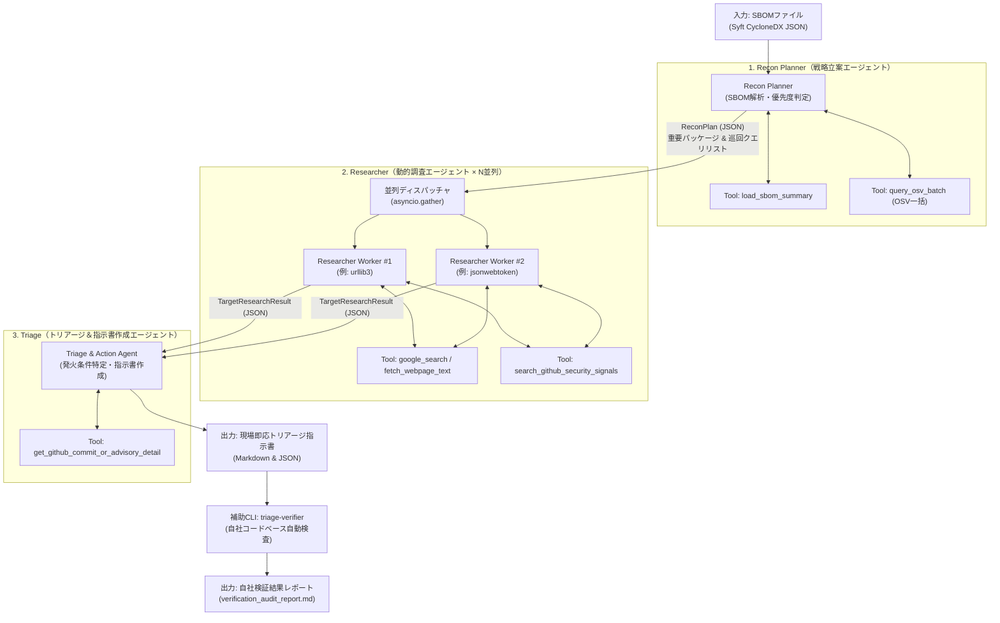

# SBOM駆動・自律型脆弱性インテリジェンス＆トリアージエージェント 設計計画書

## 1. Goal Description（システム目標と設計思想）

自社のSBOM（推移的依存を含むライブラリ一覧）を入力として、**①巡回戦略の策定（Recon Planner） → ②動的調査・先行パッチ予告の収集（Researcher） → ③発火条件の特定と即応指示書の生成（Triage）** を自律的に遂行するAIエージェントシステムを構築します。

### アーキテクチャの基本原則（Keep It Simple & Agent-Native）
- **過剰な独自オーケストレーション層を作らない:** 独自の複雑なルールエンジンやスクレイパー群をハードコードするのではなく、`google-genai` SDK（または Google ADK）のネイティブな **Function Calling（自動ツール実行ループ）**・**Google Search Grounding**・**Structured Outputs（Pydanticスキーマ強制）** を中核に据えます。
- **状態引き継ぎの型安全化（Handoff via Schema）:** 各エージェント間の連携は自由記述テキストの伝言ゲームを避け、軽量な構造化データ（JSON / Pydanticモデル）をバトンとして渡すパイプライン構成とします。
- **Pre-CVE（パッチリリース予告・RC版コミット）の捕捉:** OSV等の確定DBだけでなく、主要OSSの公式セキュリティメーリングリスト、GitHub Releases / Security Advisories、直近のマージコミット・PRを能動的に検索できる仕組みを組み込みます。

---

## 2. マルチエージェントの役割分担と協調アーキテクチャ

「3フェーズの直列パイプライン ＋ Researcherの並列ワーカー実行」というシンプルかつ拡張性の高いトポロジーを採用します。

---

## 3. 最小限のツールセット（Capabilities）

1. `load_sbom_summary(sbom_path)`: Syft CycloneDX / JSON からパッケージ名・バージョン・PURL・エコシステムを抽出。
2. `query_osv_batch(components)`: OSV.dev 一括照会 API (`POST /v1/querybatch`) で既知CVEを高速バッチ取得。
3. `search_github_security_signals(repo, keywords)`: GitHub Security Advisories、Recent Releases (RC/Pre-release)、関連コミットを探索。
4. `get_github_commit_or_advisory_detail(repo, ref)`: 特定のAdvisory全文やコミットPatch Diffを取得。
5. `fetch_webpage_text(url)`: セキュリティブログやメーリングリストのHTML本文テキスト化。
6. `google_search` (Built-in Grounding): GeminiネイティブのGoogle検索グラウンディング。
