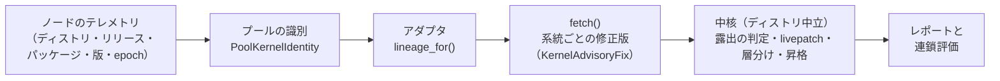

# カーネル脆弱性の照会元：ディストリ対応表と寄稿の手引き

`--kernel-auto`（[攻撃連鎖の評価](exploit-chain.md) の ④）は、各ノードプールで動いているカーネルの版を、ディストリの勧告と突き合わせます。どのディストリをどこから引くかは、[`src/triage_agent/chain/kernel_sources.toml`](../src/triage_agent/chain/kernel_sources.toml) に登録した**照会元アダプタ**で決まります（ADR-021）。

このページは、対応状況の一覧と、新しいディストリに対応させるための手引きです。

---

## 1. ディストリ対応表

| ディストリ（os-release の `ID`） | アダプタ | 修正版の出どころ | 修正版がまだない CVE | livepatch | 既知の制約 | 確認日 |
| :--- | :--- | :--- | :--- | :--- | :--- | :--- |
| Amazon Linux 2023 / 2（`amzn`） | `alas` | リポジトリの `updateinfo.xml`（ALAS） | 見えません（勧告に載らないため） | `kernel-livepatch-*` を対応付け | 重大度は勧告単位（1 件の勧告に数十件の CVE）。AL2 の Extras（5.10 / 5.15）は登録したリポジトリのみ | 2026-11-02 |
| Ubuntu（`ubuntu`） | `osv` | OSV.dev（`Ubuntu:<release>[:LTS]`、ソースパッケージ単位） | 見えます（OSV の CVE ごとの記録） | 未対応（Canonical Livepatch は数えません） | 古いカーネルでは約 1 万件。修正版と重大度は層 1・2 のものだけ取得 | 2026-11-02 |
| Debian（`debian`） | `osv` | OSV.dev（`Debian:<major>`） | 見えます | 未対応 | Ubuntu と同じ | 2026-11-02 |
| AlmaLinux / Rocky Linux（`almalinux` / `rocky`） | `osv` | OSV.dev（勧告単位） | 見えません | 未対応 | CVE を含まないバグ修正の勧告は対象外 | 2026-11-02 |
| RHEL 8 / 9 / 10（`rhel`） | `rhel` | OSV.dev の Red Hat 勧告（`Red Hat:enterprise_linux:<major>::baseos`） | 見えます（Red Hat Security Data API の CVE ごとの状態） | 未対応（kpatch は数えません） | 本流と比べるため、EUS / AUS で直ったものも露出と出ます（安全側）。`kernel-rt` は照会不全 | 2026-11-03 |
| その他（SUSE、Bottlerocket、Flatcar など） | なし | — | — | — | 「照会元なし（手動台帳のみ）」と表示し、手動台帳だけで評価します | — |

照会元とは別に、CVE ごとの CVSS は Red Hat Security Data API から一括で取得し、すべてのディストリで並び順と昇格の判定に使います（`[signals.cvss]`）。

どの照会元でも、次のことは同じです。

- **調べられなかったものを「未修正なし」と扱わない**: 照会に失敗したプール、照会元の無いディストリ、照会元が記録を持たないパッケージは、それぞれ「照会不全」「照会元なし」として表示します。
- **系統の違う修正版を当てない**: 系統（lineage）は `ディストリ:リリース:パッケージ@上流の系列` です（例: `amzn:2023:kernel6.12@6.12`）。Amazon Linux 2 の `kernel` 4.14 と 5.10 のように同じ名前で系列が違うものも区別します。
- **出典を残す**: 勧告の URL と取得日時をレポートに出します。
- **外部に送るもの**: [データの取り扱い](data-handling.md) の一覧にあるものだけです。ホスト名やノード ID は送りません。

---

## 2. 仕組み



中核（`chain/kernel_exposure.py`、`chain/kernel_history.py`）はディストリ名を一切知りません。アダプタが返す正規化された形だけを扱います。アダプタが守る約束は [`chain/sources/base.py`](../src/triage_agent/chain/sources/base.py) にあります。

| 約束 | 具体的には |
| :--- | :--- |
| 系統の一致 | `lineage_for()` は、正確に特定できない場合は `None` を返す（中核が「系統を特定できない」と表示します） |
| 照会不全の開示 | 取得や解析に失敗したものは `SourceResult.errors` に入れる。系統の情報を取れたときだけ `lineages_covered` に入れる |
| 出典 | `source_url` と `retrieved_at` を付ける |
| 重大度 | ディストリの尺度を `critical / high / medium / low / unknown` に対応付ける |
| 修正版なし | ディストリが「影響あり・修正版なし」と示すものは `fixed_evr=None` で返す（中核が「修正版なし」として露出扱いにします） |
| 版ごとの回答 | 「この版に影響する脆弱性」を返す照会元は、`affected_confirmed=True` と `applies_to_versions` を付ける |
| 大量の記録 | 詳細の取得が重い照会元は `details_pending=True` で返し、`enrich()` で層 1・2 のものだけ詳細を取る |

---

## 3. 新しいディストリに対応させる（寄稿の手引き）

既存のアダプタで足りる場合は、**`kernel_sources.toml` の変更だけ**で対応できます。たとえば OSV.dev に ecosystem があるディストリは、`[adapters.osv]` の `distros` と `[adapters.osv.ecosystems]` に 1 行ずつ足すだけです。

```toml
[adapters.osv]
distros = ["ubuntu", "debian", "almalinux", "rocky", "newdistro"]

[adapters.osv.ecosystems]
newdistro = "NewDistro:{major}"
```

照会元が新しい場合は、アダプタのクラスを書きます。

1. **事前検証をする**: 実データで、次のことを確かめてください。結果は Pull Request に書いてください。
   - 実機のカーネルの版で照会したときに何件返るか。
   - 修正版が epoch 付きで取れるか。
   - 系列（例: 6.1 と 6.12）を区別できるか。
   - 修正版がまだない CVE が見えるか。
2. **アダプタを書く**: `src/triage_agent/chain/sources/<name>.py` に `KernelAdvisoryAdapter` を継承したクラスを置き、`lineage_for()` と `fetch()` を実装します。ディストリ固有の処理はこのファイルの中だけに書き、中核には書きません。
3. **登録する**: `kernel_sources.toml` に `[adapters.<name>]` を足します。`class`・`description`・`distros`（os-release の `ID`）・`verified_at`（事前検証の日付）は必須です。
4. **テストを書く**: 実データを小さく切り出したものを `tests/fixtures/` に置きます（ネットワークにつながずに動くこと）。合成したデータを混ぜる場合は、そのことをファイルに明記してください。少なくとも次を確かめます。
   - 実機の版から系統を正しく特定できる。特定できないものは `None` になる。
   - 修正済み・未修正・修正版なしが正しく分かれる。
   - 照会に失敗したとき、オフラインでキャッシュが無いとき、照会元がパッケージを知らないときに、プールが `source_error` になる（「未修正なし」にならない）。
   - 出典の URL が付く。
5. **この表を更新する**: 「1. ディストリ対応表」に 1 行足します（テスト `tests/test_kernel_sources_doc.py` が、登録したアダプタがこの表に載っているかを確かめます）。
6. **ベンチマークを確認する**: `python -m triage_agent.cli --benchmark` が全件合格することを確かめます。中核の振る舞いに関わる変更なら、`benchmark/manifest.json` の `kernel_auto_cases` にケースを足してください（[評価セット](benchmark.md)）。

### Pull Request に書いてほしいこと

- 対象のディストリとリリース、事前検証の日付と結果（件数、取れた項目、取れなかった項目）
- 既知の制約（表の「既知の制約」に書く内容）
- 照会のときに外部へ送るもの（[データの取り扱い](data-handling.md) に足す行）

### CVSS などのシグナルの照会元を差し替える

`[signals.cvss]` の `class` を、`lookup(cve_ids, offline) -> {CVE: {"vector", "score", "source", "source_url"}}` を持つクラスに差し替えられます。照会元を切り替えた直後の値の違いは「引き上げ」とは扱いません（`source` で区別します）。

---

## 4. 関連

- 設計の判断: [ADR-021](decision.md)
- 使い方と運用: [攻撃連鎖の評価](exploit-chain.md)
- 外部通信: [データの取り扱い](data-handling.md)
